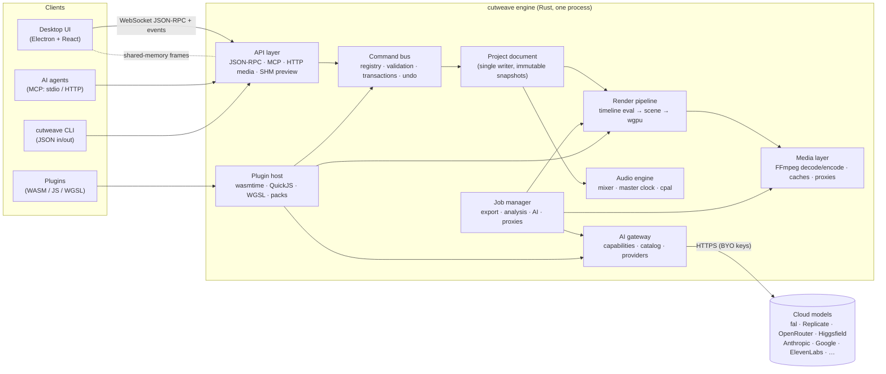
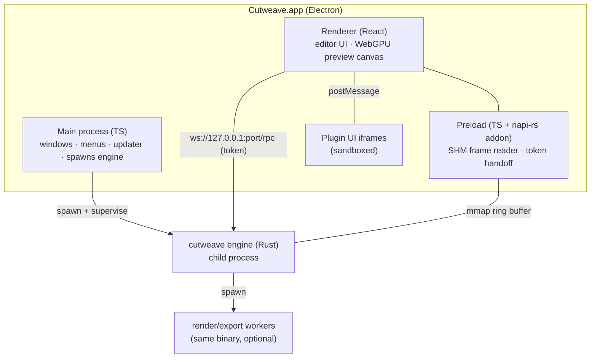
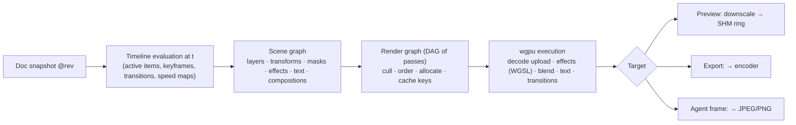
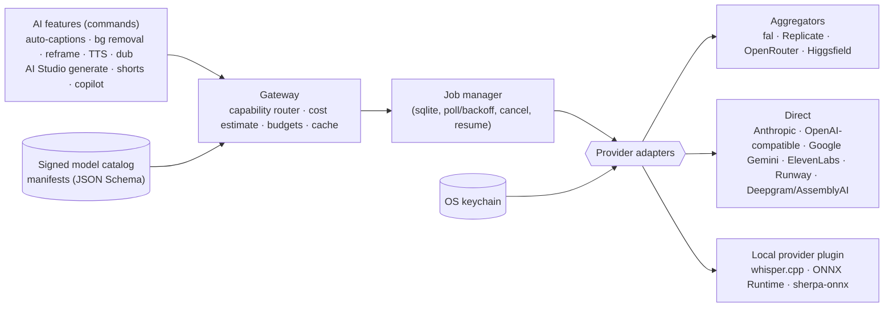

# Cutweave — System Architecture

> Status: **v1 baseline, 2026-11-22.** This doc is the source of truth for structure and contracts.
> Items marked **[Spike n]** are hypotheses until the named spike passes (see [04-roadmap.md](04-roadmap.md)).
> The research behind each choice is in [`research/`](research/). Versions are pinned in [02-tech-stack.md](02-tech-stack.md).

---

## 1. System overview

Cutweave is **one headless engine with many clients**. The desktop UI is not special: it uses the same command API as the MCP server, the CLI and plugins.



**Core guarantees**

| Guarantee | Mechanism |
|---|---|
| Anything the UI can do, an agent can do | Every mutation is a registered `Command`; UI, MCP and CLI all dispatch through the same bus (§5) |
| Agents never need screenshots | State is queryable as structured data; frames, filmstrips and waveforms are returned as images (§6, §14) |
| Every edit is undoable and replayable | Commands emit invertible patches; journaled to disk (§5, §17) |
| Preview matches export | One deterministic render pipeline with a quality ladder (§8) |
| Built-ins use the same interfaces as plugins | Built-in effects, transitions, providers and compositions ship as first-party plugins (§15) |

---

## 2. Process model



- **One binary, many modes.** `cutweave` is a single Rust executable:
  - `cutweave engine` runs the daemon the GUI uses.
  - `cutweave mcp --attach` is an MCP stdio proxy to the running GUI engine.
  - `cutweave mcp --headless` is an MCP server on an in-process engine.
  - `cutweave exec` / `cutweave query` send JSON commands.
  - `cutweave render` performs headless export.
  - `cutweave worker` is an internal parallel-export worker.
- **Engine in its own process.** A GPU, decoder or plugin crash in the engine never takes down the UI. The main process restarts it, and the engine recovers from the journal (§17). The UI then resyncs from a fresh snapshot.
- **ADR-001: why Electron, not Tauri or GPUI.** **[Spike 1]**
  - Electron gives identical Chromium, with WebGPU, WebCodecs and SharedArrayBuffer, on Windows, macOS and Linux.
  - Tauri's Linux webview (WebKitGTK) lacks WebGPU and performs poorly. Its native-surface-under-webview pattern is unsolved on Wayland and has z-order and resize issues on every OS.
  - GPUI (pre-1.0) would force a Rust-only UI. It kills the iframe plugin-UI story and is much harder for contributors and AI coding agents.
  - Cost: about 120 MB of install size and memory, which is acceptable for a video editor that already ships FFmpeg and GPU runtimes.
  - The engine is UI-agnostic by contract, so a shell swap only costs the UI.
  - Spike 1 tests the Electron preview path and compares GPUI if it fails.
- **Preload & sandbox.** Electron cannot load native modules in a *sandboxed* preload.
  - The **main editor window** uses a non-sandboxed preload with `contextIsolation`, no `nodeIntegration`, a narrow `contextBridge` API, local `app://` content only and a strict CSP.
  - All other windows and plugin iframes are sandboxed and get no preload.
  - The alternative is the addon in a utility process that sends frames over `MessagePort`. Spike 1 measures both, and ADR-001 records the choice.

---

## 3. Repository layout

```
cutweave/
├─ Cargo.toml                 # Rust workspace
├─ package.json, pnpm-workspace.yaml
├─ crates/
│  ├─ cutweave-model/            # project document types, flicks time, IDs, schema + migrations (wasm-safe)
│  ├─ cutweave-commands/         # Command/Query traits, registry, tx + patches, undo, derive macros
│  ├─ cutweave-commands-derive/  # #[command] / #[query] proc-macros
│  ├─ cutweave-ops/              # all built-in command & query implementations (timeline, clip, text, …)
│  ├─ cutweave-media/            # MediaBackend trait + FFmpeg impl: probe, index, decode, encode, mux, HW accel
│  ├─ cutweave-cache/            # frame cache, thumbnail/filmstrip, waveform pyramids, proxy manager, sqlite index
│  ├─ cutweave-render/           # timeline eval → scene graph → render graph → wgpu passes; color mgmt (wasm-safe core)
│  ├─ cutweave-text/             # shaping (cosmic-text/swash), glyph atlas/MSDF, rich text layout, text animators
│  ├─ cutweave-audio/            # mixer graph, effects, resample, time-stretch, loudness, cpal output, clock
│  ├─ cutweave-playback/         # transport, A/V sync, prefetch, scrub scheduler, SHM frame publisher
│  ├─ cutweave-jobs/             # persistent job queue (sqlite), progress, cancel, GPU budget
│  ├─ cutweave-ai/               # AI gateway: capabilities, manifests, catalog, adapters, keys, cost, provenance
│  ├─ cutweave-compose/          # programmable compositions: oxc transpile, QuickJS runtime, scene API
│  ├─ cutweave-plugins/          # plugin manager, manifest, permissions, wasmtime host, WGSL effect loader, packs
│  ├─ cutweave-interchange/      # OTIO, SRT/VTT/ASS, FCPXML/EDL, (stretch) CapCut draft import
│  ├─ cutweave-api/              # JSON-RPC over WS, MCP (rmcp), HTTP media endpoints, auth, SHM ring
│  ├─ cutweave-engine/           # composition root: wires everything, session lifecycle
│  ├─ cutweave-cli/              # `cutweave` binary (engine | mcp | exec | query | render | worker | plugin)
│  └─ cutweave-bridge/           # napi-rs addon for Electron preload (SHM reader, perf counters)
├─ apps/
│  └─ desktop/                # Electron main + preload, packaging (electron-builder)
├─ packages/
│  ├─ protocol/               # GENERATED TS types + typed RPC client (from Rust schemas)
│  ├─ editor/                 # React editor app (panels, inspector, preview, stores)
│  ├─ timeline/               # Canvas2D virtualized timeline renderer + interaction state machine
│  ├─ ui/                     # design system (shadcn/Radix/Tailwind tokens), schema-driven form renderer
│  ├─ plugin-sdk/             # MIT: TS SDK for UI panels + composition authoring (@cutweave/sdk)
│  └─ compose-runtime/        # MIT: scene API used inside QuickJS (interpolate, spring, nodes, text fx)
├─ wit/                       # MIT: WIT packages for WASM plugins (cutweave:effect, cutweave:provider, cutweave:importer…)
├─ plugins/                   # first-party plugins (effects, transitions, providers, caption styles, packs)
├─ catalog/                   # AI model catalog sources (built + signed in CI)
├─ agent-kit/                 # skills/ (SKILL.md), packs/ (presets, prompt packs), evals/ (task suites)
├─ schema/                    # GENERATED commands.json / queries.json (snapshot-gated)
├─ testdata/                  # media corpus manifest (fetched, not committed), golden frames (LFS)
├─ bench/                     # benchmark projects + budgets config (§19)
├─ spikes/                    # Phase 0 throwaway prototypes (never depended on)
├─ xtask/                     # cargo xtask: codegen, golden, corpus, release helpers
├─ scripts/                   # ffmpeg-fetch, wbs-to-issues, notices, etc.
├─ justfile
└─ docs/
```

**Dependency rule:** `model` ← `commands` ← `ops`; `render`/`audio`/`media` never depend on `api` or UI. `cutweave-model`, `cutweave-commands`, `cutweave-render` core and `cutweave-text` must compile to `wasm32-unknown-unknown` (CI-checked). This keeps the future browser build open (§22).

---

## 4. Domain model (`cutweave-model`)

### 4.1 Time

- **Unit: flicks** (1/705,600,000 s) as `i64`. Every common frame rate (23.976, 24, 25, 29.97, 30, 50, 59.94, 60, 120) and audio rate (44.1k, 48k, 96k) divides it exactly. That gives frame-exact integer math with no float drift. *(ADR-004)*
- Each sequence has a `FrameRate` (rational). The helpers `frame_to_time`, `time_to_frame(floor/nearest)` and `snap_to_frame` are the only allowed conversions.
- **Wire format:** `Time` serializes as a JSON **integer** (flicks) and maps to TS `number`. It is validated as a safe integer (|t| < 2⁵³ flicks ≈ 147 days, far beyond any timeline). Inputs also accept timecode strings (`"00:01:02:03"`, `"62.5s"`, `"f:1500"`), which are normalized on parse. Frame-based forms (`HH:MM:SS:FF`, `f:N`) resolve against the frame rate of the sequence that owns the command's target, at validation time. Commands with no sequence context accept only flicks or seconds (`"62.5s"`). *(Decided after Spike S5.)* The specta export uses a type override for the `Time` newtype.
- Media source times stay in the **stream timebase** until mapped. VFR sources are mapped through the media index (§7), never by assuming a constant fps.

### 4.2 Entities (all IDs are UUIDv7 strings with type prefixes: `med_…`, `seq_…`, `trk_…`, `itm_…`)

```text
Project
 ├─ meta { name, created, schema_version, app_version }
 ├─ settings { default_format, color, autosave, proxy_policy }
 ├─ media: Map<MediaId, MediaAsset>         # imported or generated files (by reference)
 ├─ sequences: Map<SequenceId, Sequence>    # many per project (e.g. long-form + N shorts)
 ├─ transcripts: Map<TranscriptId, Transcript>
 ├─ compositions: Map<CompositionId, CompositionDef>   # code templates stored in project
 ├─ assets: { fonts, luts, packs (plugin refs) }
 └─ markers, tags, custom (plugin-namespaced data)

MediaAsset { id, kind(video|audio|image|sequence-ref), path_abs, path_rel, content_hash,
             probe{streams, duration, fps, vfr, rotation, color{primaries,transfer,matrix,range}, audio{rate,channels}},
             proxy?: ProxyRef, analysis{scenes?, beats?, loudness?, waveform_ref}, provenance?: Provenance }

Sequence { id, name, format{width,height,frame_rate,sample_rate,color_space,background},
           tracks: Vec<TrackId> (top→bottom), main_track?: TrackId (magnetic), markers, in_out? }

Track { id, kind(video|audio|text|caption|adjustment), items (sorted by start), name,
        muted, hidden, locked, solo, gain, magnetic: bool }

Item (enum, common: id, track, start, duration, enabled, linked_group?, name, color_label)
 ├─ Clip { media, source_in, speed: Speed(Constant|Curve), reverse, freeze?, audio{gain,pan,fade_in,fade_out,eq…},
 │         visual: VisualProps, effects: Vec<EffectInstance>, masks: Vec<Mask> }
 ├─ Text { content: RichText, style: TextStyleRef|inline, box, animation{in,out,loop}: AnimRef, visual }
 ├─ Caption { transcript, word_range | text, style: CaptionStyleRef, layout }   # one block of caption track
 ├─ CompositionInstance { composition (id@ver or plugin ref), props: Map<String, Animatable<Value>>, visual }
 ├─ Generator { generator (plugin ref), params }     # solid, gradient, shapes, particles…
 └─ Adjustment { effects }                            # applies to everything below on the track stack

Transition { id, track, a: ItemId, b: ItemId, kind (plugin ref), duration, alignment(center|start|end), params }

VisualProps { transform{position, scale, rotation, anchor}, crop, opacity, blend_mode, flip, background_fill? }
             — every field is Animatable<T>

Animatable<T> = Static(T) | Keyframes(Vec<Keyframe<T>{ t (item-relative flicks), value, interp(hold|linear|bezier{…}|spring{…}) }>)

EffectInstance { id, effect: PluginRef("cutweave.fx.gaussian-blur@1"), enabled, params: Map<ParamId, Animatable<Value>> }

Transcript { id, source{media, stream} | synthetic, language, words: Vec<Word{text, start, end, conf, speaker?}>,
             segments, provenance }

Provenance { origin(import|record|ai), provider?, model?, prompt?, seed?, params?, cost?, created, c2pa? }
```

### 4.3 Model rules

- **No overlaps within a track, ever.** "Overlay" / picture-in-picture content lives on additional video tracks. Like CapCut, dropping an item where it would overlap **auto-creates a new track** above. The invariant is property-tested.
- **Overlap policy on insert (decided in WP-1B.05):** `timeline.insert` rejects an overlap by default, which is explicit and safe for agents. Callers opt into CapCut behaviour with `overlap: "new_track"` (the UI's drag-and-drop passes it), which auto-creates a track above.
- **Edit semantics (decided in WP-1B.06):**
  - Every time param snaps to the nearest frame of the item's sequence (ties go later); the result reports the time used.
    `timeline.insert` snaps `at` and `duration` (at least one frame) the same way; `source_in` is a media position and is not snapped.
  - `clip.split`: the left half keeps the item ID and the right half gets a new one. Linked partners that contain the split time split too, and the right halves share a *new* `linked_group`.
  - Linked groups move, trim, split and delete together. `unlink: true` on `item.move` and `clip.trim` edits only that item and removes it from its group. A group never keeps a single member: when an edit (`unlink: true`, `track.remove`) leaves one item alone in its group, that item is unlinked in the same transaction. If that item sits on a locked track the edit fails with `Locked` instead (it never leaves a lone member behind).
  - `item.move` takes `start` and accepts `overlap: "new_track"` like `timeline.insert`. Edits never ripple, and trims never push a neighbour.
  - An edit touching any locked track (partners' tracks included) fails with `Locked` and applies nothing.
- **Compound clips** are nested sequences referenced as media (`MediaAsset.kind = sequence-ref`). They render recursively and may not reference themselves; cycle detection is enforced.
- **Normalized, ID-addressed.** Nothing refers to anything by index. Agents and the UI address by ID, which is stable across sessions.
- **CapCut magnetic main track** is a track flag: `magnetic: true` gives ripple-by-default semantics. Linked items ("attached to main clip") move with their parent via `linked_group`.
- **Plugin data** goes only into namespaced `custom` maps, so it can never corrupt core fields.
- **Schema versioning:** `schema_version` plus ordered migrations (`vN → vN+1`) with golden fixture tests. Projects from newer app versions open read-only with a warning.

---

### 4.4 Model v1 implementation decisions (WP-1A, 2026-11-22)

- **`TimeInput` vs `Time`:** `TimeInput` (command params) resolves timecode and `f:N` strings in the owning sequence's context. `Time` (stored values) accepts only flicks or `"62.5s"`.
- **IDs:** IDs are `<prefix>_<32 hex>` (UUIDv7). Linked groups use `grp_`. Generators sit behind `IdGen`: `Uuid7Gen` in production, `SeededGen` (SplitMix64 plus a counter timestamp) for `--deterministic-ids`.
- **Deterministic IDs, decided in WP-1B.08:** one entity stream per engine (`SeededGen(seed)`, counter in the timestamp field) plus separate streams for request ids (`seed ^ REQUESTS`) and job ids (`seed ^ JOBS`). The streams continue across project swaps in one engine and, through the journal, across crash recovery. **Reopen rule:** a new engine that opens a saved project resumes the entity stream *past the highest counter that the document's own IDs show for this seed* (`Project::seeded_id_high_water`), so it never mints an ID the document holds; IDs from other seeds or real UUIDv7s are ignored. The scan depends only on the document, so the run stays reproducible. Deterministic mode also freezes the engine clock at the Unix epoch, which stamps `meta.created` (`1970-01-01T00:00:00Z`) and every request timestamp, so identical scripts save byte-identical `.cutweave` files (harness: `cutweave_engine::determinism`). Gui engines refuse the mode unless `--i-know-this-is-a-test` is passed.
- **Track storage:** sequences store `tracks` keyed by ID plus an explicit `track_order`. Items carry no `track` back-reference; it is derived.
- **Strict documents:** every document field is required except `Option`s, and new fields arrive only through migrations. Unknown fields are kept in a flattened `extra` map, so newer files round-trip read-only.
- **Transform units:** normalized to the canvas and the item. WP-1F.02 must confirm this against the compositor.
- **Frame rates:** sequence frame rates must be exact in flicks and between 1 and 1000 fps.

## 5. Command bus & state (`cutweave-commands`, `cutweave-ops`)

### 5.1 Commands, queries, events

```rust
/// Defined once; generates JSON Schema, TS types, MCP tool/catalog entry, CLI help and docs.
#[command(
    name = "clip.split",
    summary = "Split an item at a timeline time",
    undoable,
    mcp = "core",                    // core | catalog | hidden
    annotations(destructive = false, idempotent = false)
)]
pub struct SplitItem {
    pub item: ItemId,
    pub at: Time,                    // flicks, or "00:01:02:03" / "62.5s" accepted by parser
}

impl Command for SplitItem {
    type Output = SplitOutput;       // { left: ItemId, right: ItemId }
    fn apply(&self, tx: &mut Tx) -> Result<Self::Output, CmdError> { /* mutate via tx API */ }
}
```

- **Commands** mutate. Naming is `namespace.verb_object`. The namespaces are `project`, `media`, `sequence`, `track`, `timeline`, `item` (generic ops on any item kind: delete, move, set_props, duplicate, link), `clip` (media-clip specifics), `text`, `caption`, `transcript`, `effect`, `transition`, `keyframe`, `mask`, `color`, `audio`, `composition`, `template`, `font`, `asset` (packs, stickers, LUTs, library items), `analysis` (scene/beat/loudness/silence detection results), `job` (job status, wait, cancel, list), `tracking` (motion tracking; distinct from timeline `track`), `ai`, `render`, `export`, `plugin`, `edit` (undo/redo/history), `view` (UI-only state such as playhead, zoom and selection). New namespaces require an ADR.
- **Queries** are read-only (e.g. `timeline.get`, `item.get`, `media.list`, `transcript.search`, `render.frame`). They support `depth`, `fields`, `limit` and `cursor` so responses stay small.
- **Events** are streamed to subscribers: `doc.patched{rev, actor, ops}`, `playback.state`, `job.progress`, `media.indexed`, `plugin.changed`, `catalog.updated`.
- **Envelope & idempotency:**
  - Every command call carries a client-generated `request_id` (UUIDv7) and an optional `expected_rev`.
  - The engine journals `request_id` with each applied transaction and deduplicates repeats within a 10-minute window: a repeat returns the original result. After an engine restart, clients resend unacknowledged requests safely.
- **`view` namespace** covers playhead, zoom, selection, panel state and preview quality. It is **not undoable and not journaled**; it persists separately in `.cutweave/ui-state.json`.
- **Deterministic test mode:** `--deterministic-ids <seed>` replaces UUIDv7 generation with a seeded sequence. Parity tests (CLI = MCP = RPC) and golden tests can then byte-compare saved project documents.
- **Error semantics (decided in WP-1B.01):**
  - `Locked{kind,id,by,tx}` means the target is *user-locked* (locked track or item).
  - Contention with another actor's open gesture is `Conflict{reason:"item_in_gesture", retry_after_ms}` (§5.2).
  - Patch ops follow RFC 6902 (`replace` carries `value`). `move` into a path's own descendant is rejected so every op stays invertible.
- **Registration is explicit:** each crate that defines commands exposes `register(&mut Registry)`, and the engine composition root calls them all. No link-time registration magic, so this works identically on native and wasm32 and nothing is silently dropped by the linker. *(Decided after Spike S5.)*
- **Validation** happens before apply: JSON Schema, then semantic checks (IDs exist, ranges, locks). Errors are typed (`NotFound`, `Locked`, `Conflict{current_rev}`, `Invalid{path,msg}`, `Unsupported`). Each error carries a human message plus a machine code; agents rely on both.

### 5.2 Transactions, undo, concurrency

- **Single-writer document actor.** All commands execute serially on the doc actor. Readers (render thread, queries, audio) get **immutable snapshots** (persistent structures via `imbl`; `Arc` swap per revision), so there are no locks on the hot path.
- `Tx` records **forward and inverse patch ops** as it mutates. Undo applies the inverse ops; redo reapplies the forward ops. Property tests assert `undo(apply(doc)) == doc` for every command.
- **Transactions group commands** into one undo step:
  - Clients may wrap a batch in `edit.begin_tx / edit.commit_tx`.
  - `cutweave_execute` (MCP) is a transaction by default.
  - **Ephemeral transactions** cover continuous gestures (dragging, scrubbing a slider). They update the doc live but collapse into one undo entry on commit, or roll back on cancel.
- **Gestures vs. concurrent actors.** All commands are serialized on the doc actor, so history is always linear.
  - An open ephemeral transaction holds a **soft lock on the items it touches**. Another actor's command that touches one of those items fails fast with `Conflict{reason:"item_in_gesture", retry_after_ms}`.
  - Commands on other items proceed normally. Undoing a gesture inverts only its own ops, which stays valid because the ops are on disjoint items.
  - **Transaction kinds and ownership:**
    - A transaction is owned by the connection that opened it, and a dropped connection rolls it back.
    - `gesture` transactions auto-cancel after 30 s without updates.
    - `proposal` transactions (copilot, §14b) have no idle timeout and are cancellable.
  - **Saves and autosaves persist only the last *committed* revision**, never in-flight ephemeral edits. A minimal soft-lock ships in P1; P2 adds retry semantics and UI feedback.
- **Actors & optimistic concurrency.** Every tx is tagged with an actor (`user`, `agent:<label>`, `plugin:<id>`, `system`). The actor is **derived server-side from the credential** (§6), never asserted by the client. Clients may pass `expected_rev`; a stale rev fails with `Conflict`. History is per actor, so you can "undo the agent's last change" without touching your own edits.
- **Revisions (decided in WP-1B.03):**
  - `rev` bumps on every live change, including ephemeral edits; `committed_rev` tracks committed state. A snapshot is committed exactly when `rev == committed_rev`.
  - Implicit (single) commands run against the committed document. One that overlaps an open transaction's items fails with `Conflict{item_in_gesture}`.
  - The doc actor is a dedicated OS thread, not a tokio task; readers use arc-swap and never lock.
  - After crash recovery in deterministic-ID mode, the seeded ID generator state must be restored from the journal (WP-1C.02).
- **Undo rule (decided in WP-1B.04):**
  - An undo is a *new* transaction that applies the inverse patch to the current document, so it carries past later edits to unrelated fields.
  - It is refused with `Conflict{history_target_modified}`, naming the later changes and their actors, when any targeted field changed since, or when the result would violate a model invariant.
  - `edit.undo{actor}` / `edit.redo{actor}` take `*` for "anyone's latest". A commit is refused when later commits invalidated the transaction.
  - In P1, checkpoints are in memory only; journal persistence comes later.
- **Soft-lock (decided in WP-1B.09):**
  - `gesture` and `proposal` transactions lock every item they touch, including items they create and changes above them (for example removing the item's track). `batch` transactions lock nothing, but their commit waits.
  - Another actor's change to a locked item fails with `Conflict{item_in_gesture, retry_after_ms}`. The hint is the time left until the gesture's idle deadline, at least 250 ms; proposals give none. The holder's own actor is not blocked.
  - `edit.locks` lists open transactions with their locked items and deadlines. Events: `tx.opened`, `tx.locked`, `tx.closed`.
  - A closed connection ID can never open transactions again, so the API server (WP-1I.02) must not reuse connection IDs. A `holder` field on the error would be a contract change (ADR).
- **Checkpoints:** `edit.checkpoint{name}` and `edit.restore{checkpoint}` (cheap, thanks to persistent snapshots) let agents try something and roll back.
- **Future collaboration:** patch ops are designed to map onto a CRDT (Loro) later; no CRDT in v1 *(ADR-005)*.

### 5.3 Generated artifacts (build step, CI-enforced)

The registry produces the following, each committed and checked against snapshot tests (diff = review required):

- `schema/commands.json` and `schema/queries.json`: the full JSON Schema catalog
- `packages/protocol/src/generated/*.ts`: TS types and a typed RPC client (via `specta`)
- The MCP catalog (§14) and CLI subcommand help
- `docs/reference/commands.md`

**Decided in WP-1N.01:** `cargo xtask gen` writes `schema/{commands,queries,events,mcp-tools,patch-fixtures}.json`, `schema/schema-hash.txt` (`SCHEMA_HASH` = sha256 of `commands.json`, also a generated constant in `cutweave-commands`), `docs/reference/commands.md` and `docs/reference/cli.md` (the `cutweave` command line, from the clap definition of `cutweave-cli`, WP-1K.01). `cargo xtask gen --check` (part of `just check`) fails with a unified diff when a committed file is stale. `events.json` joins document events (`EVENT_CATALOG`) and engine events (project, job, media), each tagged with its `source`. MCP tool names are the command name with `.` replaced by `_`.

---

## 6. API surfaces (`cutweave-api`)

All surfaces live on **one local server per engine** (axum on `127.0.0.1`, random port). Each engine instance writes `~/.cutweave/run/<pid>.json` (port, agent token, pid, project; never the UI credential), user-only permissions, and removes it on exit.

| Surface | Path / transport | Clients | Notes |
|---|---|---|---|
| JSON-RPC 2.0 | `ws://127.0.0.1:P/rpc` | Desktop UI, scripts | Commands, queries, event subscriptions; MessagePack upgrade later if needed |
| MCP | `http://127.0.0.1:P/mcp` (Streamable HTTP) and stdio via `cutweave mcp` | AI agents | rmcp; §14 |
| Media HTTP | `GET /media/{id}/thumb?t=&w=`, `/filmstrip`, `/waveform?lod=`, `/media/frame?seq=&t=&w=&h=&fmt=jpeg` | UI ``/canvas, agents | Cacheable, content-hashed ETags |
| Preview SHM | named shared memory ring buffer | Desktop UI (preload addon) | §10 |
| CLI | `cutweave exec '<json>'`, `cutweave query …`, `cutweave render …` | Humans, CI, scripts | Attaches to the running engine or spawns headless |

**Auth & credential classes** *(ADR-016)*:
- **UI credential:** a per-launch 256-bit token handed to Electron main over the engine's spawn handshake pipe. It is **never written to disk** and reaches the renderer via preload.
  - It maps to actor `user`.
  - It is the only credential allowed the **UI-only scopes**: `ai.set_key`, minting spend/destructive approvals (§13), changing filesystem allowlists and budgets, and granting plugin permissions.
- **Agent credentials:** tokens in the run-file, used by MCP and CLI clients. They map to `agent:<label>` and can never use UI-only scopes, so a process that can read the run-file still cannot approve its own spending.
- **Plugin credentials** are issued in-process per plugin: actor `plugin:<id>`, limited to the permissions the plugin declares.
- **Network hygiene:** Host and Origin headers are checked (DNS-rebinding defense). The server binds to localhost only, and remote access is out of scope for v1.
- **Stable port:** Electron main picks the port at app launch and passes `--port` on every engine (re)start, so the renderer's CSP stays valid. If the bind fails, main picks a new port and reloads the renderer.
- **Engine root and launch protocol (decided in WP-1I.04):** the protocol is specified in [launch-protocol.md](reference/launch-protocol.md).
  - `Engine::start(EngineConfig)` wires the doc actor, project store, journal, autosave, job manager and API server; media, render, audio and playback attach later through the `Subsystems` trait (WP-1I.05).
  - Surfaces mount on an in-process dispatch API: `EngineHandle::connect(&Credential)` gives each client connection its own never-reused connection ID, and dropping it rolls back that connection's open transaction. Events reach clients through one `EngineEvent` fan-out.
  - In `Gui` mode the UI credential is the first stdin line; the engine prints a ready line (no tokens) or a JSON error line and exits with 0 clean, 1 internal, 2 usage, 10 project locked, 11 GPU init, 12 port bind, 13 handshake.
  - **Path policy:** the UI credential is unrestricted. Every other credential can only open, save or import under the `--allow-root` folders, the start project's folder and the open project's folder (symlinks resolved, `..` refused); otherwise the call fails with `Invalid`.
- **JSON-RPC wire (decided in WP-1I.02):** specified in [rpc.md](reference/rpc.md).
  - Methods are registry names plus `rpc.hello`, `rpc.subscribe`, `rpc.unsubscribe` and `project.snapshot`; events arrive as notifications named after the event. The WebSocket carries the token as subprotocol `cutweave.token.<t>`.
  - Results carry `_meta{rev, committed_rev, request_id?, tx_id?}`; errors are `{code, message, data}` with `data` = the `CmdError` wire form and fixed numeric codes (-32001 not_found, -32002 locked, -32003 conflict, -32004 forbidden, -32005 unsupported, plus the JSON-RPC standard codes).
  - Mutating calls need `_meta.request_id` (except `view.*`); a connection's mutations run in arrival order and reads may overtake them. Per-connection event queues are bounded: overflow closes the socket with 4001 `resync_required`, and clients resync by subscribing, then calling `project.snapshot`.

---

## 7. Media pipeline (`cutweave-media`, `cutweave-cache`)

- **Backend:** FFmpeg through `ffmpeg-next`, behind a `MediaBackend` trait *(ADR-003)*. FFmpeg ships as a pinned shared build. Because Cutweave is GPL-3.0, the full GPL build (x264/x265, etc.) may be bundled. See §21 for patent notes.
- **Import:** `media.import` probes synchronously (with a timeout) and returns `media_ids` immediately, and agents wait on background work with `job_wait`. Background jobs then build the **frame index** (pts → keyframe/GOP map), compute a content hash for relinking, extract a waveform pyramid and generate thumbnails. Optional analysis jobs cover scene cuts, beats, loudness and transcription.
- **Jobs and analysis (decided in WP-1D.07):**
  - `cutweave-jobs` runs one job per (asset, analysis stage), ordered by stage dependencies, under per-class budgets (decode-class = cores/2, export = 1). Finished jobs go to a bounded in-memory history; the `cache.sqlite` history arrives with 1D.05.
  - `job.status`, `job.list`, `job.wait` (≤ 60 s) and `job.cancel` are engine commands, not document queries. `job.cancel` is not journaled (`#[command(engine, journaled = false)]`).
  - **Analysis status is not document state.** A failing stage is a failed job plus a `media.analysis_failed{media_id, stage, job_id, error}` event; analysis never writes to the project, so undoing an import is never blocked by it. Analysis re-runs after a restart, served from the caches.
  - `media.import` is partial: unreadable or timed-out files go to `failed[]` with a code. In agent and headless mode paths must sit inside the allowed roots.
- **Decode:**
  - A decoder pool runs per media.
  - **Frame-exact seek** works by keyframe seek plus decode-forward, using the index.
  - A GOP cache handles scrubbing.
  - Hardware decode uses D3D11VA/NVDEC on Windows, VideoToolbox on macOS and VA-API on Linux.
- **GPU upload:** v1 uploads NV12/P010 planes from the CPU to wgpu and converts colorspace in a shader. **Zero-copy interop** (DX12 shared handles, IOSurface/Metal, dmabuf→Vulkan) is a later optimization behind a feature flag. **[Spike 3]**
- **Proxies:** auto-proxy policy for long-GOP or over-1080p media (configurable). Proxies are intra-frame (ProRes Proxy / DNxHR LB, or MJPEG fallback) at ≤ 960p and live in the global cache. Preview uses proxies; export always uses the originals.
- **Caches (global, content-addressed, size-capped LRU, in the OS cache dir):** decoded frame cache (RAM), GPU texture cache (VRAM budget), thumbnails/filmstrips (disk), waveform pyramids (disk) and proxies (disk). The index lives in `cache.sqlite`.
- **Index, hash and cache (decided in WP-1D.02).** `MediaBackend::index_media` builds the frame index from a packet scan, so `FakeBackend` serves indexes too. `FrameIndex` and the content hash live in `cutweave-media`; `cutweave-cache` depends on media and re-exports them (decoding for thumbnails needs that direction). The content hash is BLAKE3 over the first and last MiB plus the size (`blake3-fast:<hex>`; `blake3-full:<hex>` hashes everything), and keys every cache entry. `cache.sqlite` evolves through append-only migrations (`PRAGMA user_version`). An index is stored as a versioned, delta-coded packet blob with a BLAKE3 checksum; frames and GOPs are rebuilt on load, and a damaged or older blob is a cache miss.
- **Encode/export:**
  - Containers: MP4, MOV, MKV, WebM, GIF, audio-only (WAV/MP3/AAC/FLAC/Opus), PNG/JPEG sequence.
  - Codecs: H.264, HEVC and AV1, each with a hardware encoder (NVENC/AMF/QSV/VideoToolbox/VA-API) or a software one (x264/x265/SVT-AV1), plus ProRes.
  - Presets cover TikTok/Reels/Shorts, YouTube 1080p/4K, archive and GIF.
- **Decoding (decided in WP-1D.03).**
  - **Pool:** one `DecoderPool` per media item, four live decoders by default with LRU eviction. Each pooled decoder runs on its own thread, so a `CancelToken` stops a pending seek in well under 10 ms; a frame-threaded FFmpeg flush can't be interrupted.
  - **Threads:** seek and scrub decoders use one thread; `DecodeMode::Sequential` uses frame threads for playback and export.
  - **Seeking:** follows ADR-0003 (index seek rule, NONREF skip, drain before flush).
  - **Output:** frames come in coded orientation (rotation comes from the probe) as NV12, P010 or planar YUV (`Yuv420p10`, `Yuv422p`, `Yuv422p10` added). Layouts without a match are converted to the nearest one.
  - **Damage:** a frame that stood in for an undecodable one carries `damaged = true`.
  - **Measured on the CPU path:** 4K long-GOP random seek p95 is about 0.5 s; hardware decode or proxies cover the 150 ms budget.
- **Export (decided in WP-1E.03).**
  - **Command:** `export.start` starts an `Export` job. It is undoable = false and journaled = false; a core MCP tool that is marked destructive.
  - **Snapshot:** the job renders the **committed** document snapshot from when it started; later edits don't affect it.
  - **Frames:** each frame is rendered on headless wgpu to the same sRGB RGBA8 target as `render.frame`, and is bit-identical to it before encoding.
  - **Audio:** the offline mixdown is fixed at 48 kHz stereo. A timeline with no audio still gets a silent track.
  - **Preset:** `h264-mp4-1080p` fits the sequence into 1920×1080, or 1080×1920 for portrait, without upscaling. Quality maps to x264 CRF 28 / 23 / 20.
  - **Missing media** is drawn as missing (an absent layer, silent audio) and counted in the final message; it doesn't fail the export.
  - **Files:** one export per output path at a time. Replacing an existing file needs `overwrite: true`. Cancel stops within a second and leaves no file.
  - **Colour:** the pixels are sRGB-encoded while the file is tagged BT.709; that decision is still open (#110).
- **Thumbnails, filmstrips and the frame cache (decided in WP-1D.05).**
  - **Frame cache:** `FrameCache` holds decoded frames in RAM, keyed by `(content hash, stream, pts)`. Its budget is the smaller of 1 GiB and a quarter of RAM, with LRU eviction. Thumbnail generation does not go through it, so thumbnail decodes never evict scrub frames.
  - **Disk cache:** thumbnails and filmstrips are JPEG files in the OS cache directory (`<cache>/cutweave/media-cache`), never in the project. Each file is a row of `disk_entries` in `cache.sqlite` (migration 2), capped at 2 GiB by default with LRU eviction. Deleting the folder loses nothing: a row whose file is missing is a miss.
  - **Requests:** a thumbnail is `(media, t, width)`; a filmstrip is a sprite of `count` tiles of `tile_w`, wrapping at 8192 px, with a manifest giving tile `i` at column `i % columns`, row `i / columns`. Neither upscales. ETags are pure functions of the request, so the HTTP layer answers `If-None-Match` with 304 without decoding or touching the cache. The HTTP layer floors `t` to the frame grid.
  - **Prefetch:** after import, an `Analysis` job (`thumbnails`) fills the cache under the decode budget; cancelling it stops the decode in flight.
  - **Not yet:** container rotation and colour conversion are not applied to thumbnails. JPEG only (no WebP).
- **Waveforms (decided in WP-1D.06).** Min/max peak pyramids (256 × 4^N samples per bin, `i16` peaks, a mono mix track plus optional per-channel tracks) are computed once per `(content hash, audio stream)` by decoding the audio. They are stored as **files** (`.cwwf`, with a checksum) in the OS cache directory, not in SQLite, with LRU eviction per cache directory. The format is in [waveform-format.md](reference/waveform-format.md). The endpoint reads a level and range as peak data or renders a PNG. Media without audio has no waveform (`NoStream`).
- **Corpus:** a test-media manifest (VFR phone footage, HEVC 10-bit HDR, ProRes, rotated, odd sample rates, broken files) is fetched in CI to gate decode correctness.

---

## 8. Render pipeline (`cutweave-render`, `cutweave-text`)



- **Deterministic per frame (the Remotion idea).** `render(snapshot, sequence, t, quality) → frame` is a pure function. Randomness is seeded from item IDs, and there are no wall-clock dependencies. This enables:
  - Caching rendered frames by `(subgraph hash, t)`.
  - **Parallel chunked export** across `cutweave worker` processes.
  - Reproducible bug reports and golden-frame tests.
- **Color:**
  - Composite in **linear light, `Rgba16Float`** working space (scene-linear Rec.709 primaries in v1).
  - Input transforms come from probe tags (matrix, range, transfer, primaries), and output transforms are per export.
  - HDR (PQ/HLG) sources are tone-mapped to SDR in v1. HDR output is v2.
  - LUTs (.cube) are applied in the specified space.
- **Color defaults (decided in WP-1F.02):** untagged SD sources are treated as BT.601; HLG uses the BT.2100 OOTF, then the same BT.2390 EETF as PQ for SDR. Preview output is sRGB with straight alpha. Minified layers sample mipmaps. Crop masks without moving the picture.
- **Blend modes:**
  - The core set ships in P2: normal, multiply, screen, overlay, darken, lighten, add (linear dodge) and soft light.
  - The extended set arrives in P4 as L1 plugins: color dodge/burn, hard/vivid/linear/pin light, difference, exclusion, hue, saturation, color and luminosity.
  - All blending is done in linear light.
- **No hidden state in effects.** Effects cannot keep persistent feedback buffers across frames, because that would break determinism. Temporal effects (echo, trails, motion blur, datamosh-style) declare **`history` taps** (input frames t−1…t−N, N ≤ 8). The render graph provides these from the frame cache, so the output stays a pure function of the inputs.
- **Golden references are stored per GPU adapter class** (software WARP/lavapipe for CI, plus reference machines), with a perceptual tolerance.
- **Effects & transitions** are WGSL effect packages (§15 L1). The built-ins are first-party packages. Effects declare passes, inputs and params, and the render graph fuses compatible passes.
- **Masks:** shape masks (rect, ellipse, polygon, bezier) with feather and invert, plus **matte masks** from AI segmentation (alpha video produced by a job) and chroma key.
- **Text (`cutweave-text`):**
  - Shaping with `cosmic-text`/`swash` (bidi, CJK, emoji, variable fonts).
  - Glyph rendering via an **MSDF atlas** for crisp, scalable, animatable text, with fill, outline, shadow, glow, gradient and per-glyph transforms.
  - A Vello path for very large or complex glyphs. **[Spike 4]**
  - Text animations are compositions (§12) applied per glyph, word or line.
- **Quality ladder (preview):** full, ½ or ¼ resolution, plus proxy vs original. The preview adapts automatically to hold frame rate during playback, then refines to full quality when paused. Export is always full quality.
- **GPU robustness:** the engine recovers from device-lost by recreating the device and rebuilding caches. The render thread has a watchdog, and per-effect timing auto-disables an effect that exceeds its budget repeatedly.

---

## 9. Audio engine (`cutweave-audio`)

- **Graph:** clip sources (decoded, resampled with `rubato`, time-stretched with `signalsmith-stretch` for speed changes and pitch preservation) feed per-item FX, then per-track bus (gain, pan, FX, meters), then the master (limiter and loudness meter via `ebur128`), then output (`cpal`).
- The **real-time thread** is lock-free and allocation-free. Decoding and stretching run ahead on worker threads into ring buffers.
- **Master clock:** during playback, the audio device clock is the master, and video presentation follows it (§10).
- **Features:** fades, keyframed volume, ducking (sidechain driven by the voice track or transcript VAD), loudness normalization to target LUFS (−14 social / −16 podcast / custom), and voiceover recording. Beat markers come from an analysis job.
- Audio FX are a plugin category: built-in DSP in Rust (EQ, compressor, reverb, denoise via provider/local model) in v1, CLAP hosting in v2 and VST3 in v3.

- **Mixer graph (decided in WP-1G.01):** clip sources → stereo downmix → resample to the device rate (`rubato`) → one lane per track (clips summed with their gain on worker threads) → track bus (gain, ramped) → master (gain, soft limiter at 0 dBFS). Each lane streams through an SPSC ring holding ≥ 500 ms; the real-time `render` never allocates, locks or makes syscalls, and replaced plans are freed by a worker. Clips cover `[time_to_samples(start), time_to_samples(end))` rounded to the nearest sample. Edits hand off sample-exactly `edit_latency` (100 ms) after the playhead; a seek re-primes every lane. The offline `mixdown` runs the same lane and bus code, so export equals playback bit for bit. Sources implement `PcmSource`; the FFmpeg `AudioDecoder` adapts to it (WP-1D.03). Real-time allocation tests use a counting allocator behind the `testing` feature (the `assert_no_alloc` crate's licence is not allowed).

- **Output and master clock (decided in WP-1G.02):** cpal 0.18 output (WASAPI and CoreAudio; Linux uses the null output until ALSA is set up in CI) or a null output (`CUTWEAVE_AUDIO=null`). A supervisor thread restarts the stream on stream errors, default-device changes and stalls; the clock never goes backwards (a restart skips forward by at most the device latency). `AudioClock` is anchored per callback and published through a seqlock, monotonic within a generation; a seek starts a new generation. The clock follows the device crystal, so it drifts against the system timer by the device's ppm error (≈ +11 ppm on the reference headset); A/V sync follows the audio clock. Pause plays silence; master and per-bus peak meters update at 30 Hz. Master volume uses `view.set {master_gain}`.

---

## 10. Playback & preview delivery (`cutweave-playback`, `cutweave-bridge`)

**[Spike 1]** This is the riskiest path, so it is prototyped first.

1. The engine renders preview frames at **preview-canvas pixel size** (not sequence size) into a GPU texture. It converts on the GPU to NV12 or RGBA8 and reads back asynchronously into a **shared-memory ring buffer**:
   - 4–6 slots.
   - The header holds an atomic write index, plus per-slot `pts`, `w`, `h`, `format`, `rev` and `seq`.
   - The **audio clock** position is written continuously.
2. A tiny **napi-rs addon** (`cutweave-bridge`) maps the ring. It runs in the main window's non-sandboxed preload, or in a utility process that forwards frames over `MessagePort`; Spike 1 decides (§2). It exposes slots as `ArrayBuffer` views, so the copy into JS is zero-copy.
3. The renderer uploads to WebGPU (`queue.writeTexture`, or `VideoFrame` → `importExternalTexture`) and draws in `requestAnimationFrame`, presenting the newest frame whose `pts ≤ audio clock`.
4. **Overlays** (transform handles, crop box, safe areas, text editing caret, guides) are DOM/Canvas layers on top of the preview canvas, all in the same page, so there are no z-order problems.
5. **Scrubbing** uses a latest-wins scheduler: stale requests are cancelled, proxies and the GOP cache are tried first, and a low-res frame is sent before the full-res refine.

**Transport (decided in WP-1H.01).** The transport lives in `cutweave-playback` behind its non-default `transport` cargo feature, so the Electron addon builds playback without the audio, render and command crates.
- **Clocks.** At 1× forward, video follows the audio clock (`clock.read()`, never `OutputState`). In P1 the other JKL rates (±2×, ±4×, all reverse rates) are video-only on the host clock with audio paused, because the mixer has no varispeed yet. 2× and 4× show every 2nd or 4th frame.
- **Frame target.** The render loop renders the frame due when the render will finish: the floor of the predicted playhead, with the lead capped at 100 ms. It drops the frames in between and never pauses or re-seeks audio to wait for video.
- **Exact latest-wins.** Every control request starts a new epoch, which cancels in-flight renders through their `CancelToken`. A frame commits only while its epoch is current, and the render side never waits; the control side waits out one in-progress commit. Once a request returns, no frame from an older request can be delivered.
- **Scrubbing** goes cache → quarter-resolution frame flagged `LOWRES` → full frame after 100 ms without a newer seek.
- **Wire.** `playback.state` is sent at most 30 times a second. The `view.play`, `view.pause`, `view.seek`, `view.set_rate`, `view.step` and `view.set_preview_size` engine commands drive the transport; `view.set_preview_size` is hidden from MCP.
- **Threads.** The render thread takes no locks and makes no per-frame heap allocation (a counting-allocator test enforces this). Its frames come through the `FrameSource` seam: synthetic frames until WP-1I.05 connects the real renderer (R31).

The upgrade path, behind a feature flag once proven, is zero-copy GPU texture sharing into Chromium via Electron's shared-texture import. **Fallback** is JPEG frames over `/media/frame`: for remote or non-Electron clients, and locally when WebGPU is unavailable or fails, when no ring is announced, or when `CUTWEAVE_PREVIEW=jpeg` forces it (CI without a GPU). The client polls at ≤ 15 fps and shows a reduced-mode banner (WP-1M.04).

---

## 11. Text, captions & transcripts

- **Transcript-first captions.** Stt (cloud or local) produces a `Transcript` with word timings. The caption track is a *view* over transcript word ranges, chunked by rules: max chars/line, max lines, min/max duration, and break on punctuation or pauses.
- **Caption styles** are packages (L0 data + optional L1.5 composition): fonts, colors, outline, shadow, background box, position, and **active-word highlight / karaoke / pop / bounce** animations. Shipping a large first-party style gallery is a v1 priority, since this is CapCut's moat.
- **Captions follow their source.** Caption items are linked (`linked_group`) to the clip whose audio produced the transcript. Moving, trimming, ripple-deleting or changing the speed of that clip re-times or removes the affected caption words, as in CapCut. Unlinking is an explicit command.
- **Text-based editing:** delete or reorder words in the transcript view, and the engine emits `timeline.ripple_delete_ranges` / `timeline.reorder_ranges`. These commands are owned by P3 (3F) if P2 has not already shipped them. **Silence and filler-word removal** use the same path.
- **Interchange:** SRT/VTT/ASS import and export. Burn-in at export, or a sidecar file.
- **Translation:** a translate capability produces a new transcript (or bilingual captions), keeping timings.

---

## 12. Programmable compositions (`cutweave-compose`) — Remotion-inspired, original implementation

Motion graphics, animated text, lower-thirds, title cards and templates can be authored in **TypeScript/JSX**:

```tsx
import { defineComposition, p, interpolate, spring, Text, Rect, Group } from "@cutweave/compose";

export default defineComposition({
  id: "acme.lower-third",
  props: p.object({ name: p.string(), title: p.string(), accent: p.color().default("#7c5cff") }),
  durationInFrames: 120,
  render: ({ frame, fps, props, size }) => {
    const x = spring({ frame, fps, from: -400, to: 80 });
    const o = interpolate(frame, [100, 120], [1, 0], { clamp: true });
    return (
      <Group opacity={o} x={x} y={size.h - 220}>
        <Rect w={520} h={110} radius={18} fill={props.accent} />
        <Text x={24} y={18} font="Inter 700" size={42}>{props.name}</Text>
        <Text x={24} y={66} font="Inter 400" size={26} opacity={0.85}>{props.title}</Text>
      </Group>
    );
  },
});
```

- **Pipeline:**
  - Source is transpiled in-engine with **oxc** (TS/JSX → JS) and run in **QuickJS** (`rquickjs`) in a sandbox: no I/O, no clock, seeded RNG, memory and time limits.
  - `render(frame)` returns a **scene-graph description** that `cutweave-render` draws with wgpu. There is no headless browser and no DOM.
- The props schema (built with `p`, a small zod-like builder) is converted to JSON Schema, which then:
  - Auto-generates the inspector UI.
  - Becomes MCP-visible parameters.
  - Makes props keyframeable.
- Built-in text animations, caption styles and many templates are themselves compositions (dogfooding).
- **Agent synergy:** an agent can write a composition through MCP (`composition.create{source}`), receive compile errors as structured diagnostics, preview it with `render.frame` and place it on the timeline. This is the main path for "make me a custom animated intro" without screenshots.
- **License hygiene:** Remotion is source-available, not OSI. We copy **no code and no API surface verbatim**; we reuse only the general ideas, which are common to Motion Canvas (MIT) and others.

---

## 13. AI gateway (`cutweave-ai`)

**Cloud-first and model-agnostic, Higgsfield-style.** Local models are just another provider.



- **Capabilities** form a closed enum, versioned with the host API:
  - Language and understanding: `Llm`, `VideoUnderstand`.
  - Speech and voice: `Stt`, `Tts`, `VoiceClone`, `VoiceConvert`, `Dub`, `LipSync`, `Translate`.
  - Image generation: `TextToImage`, `ImageEdit`.
  - Video generation: `TextToVideo`, `ImageToVideo`, `VideoToVideo`.
  - Music and sound: `Music`, `Sfx`.
  - Enhancement: `Upscale`, `Interpolate`, `Matting`, `SegmentTrack`, `AudioEnhance`, `StemSplit`.
  - Library: `StockSearch` (free/stock media APIs; licenses go into provenance).

  Each capability has a **normalized I/O type**. For example, every Stt result becomes a word-timed `Transcript`, and every generation returns `Asset[] + Provenance`.
- **Provider interface:** `submit → JobHandle`, `poll`, `cancel`, `estimate_cost`, plus `stream` for LLM, realtime TTS and STT. Adapters come in two kinds:
  - **Declarative HTTP manifests:** request templates plus a response mapping, authored as plugins with no code. Most aggregator models fit here.
  - **WASM component adapters** (`wit/cutweave-provider`) for complex APIs. **The host performs the HTTP and injects keys**; adapters never see secrets.
- **Model catalog:**
  - Each model manifest holds a params JSON Schema, limits (duration, resolution, aspect), pricing formula, status/deprecation/`replaced_by`, license/watermark flags and UI hints.
  - **CI-built, ed25519-signed, remote-updatable** with rollback protection, merged with live discovery from aggregators (fal/Replicate/OpenRouter schemas) and user-added model slugs.
  - The manifest drives the AI Studio forms, MCP tool params and cost estimates, so new models appear without an app release.
- **Jobs:**
  - Persisted in SQLite, so they survive restarts.
  - Polling with backoff (desktop has no webhooks), cancel, and retry only when the operation is safe.
  - **Results are downloaded immediately** (provider URLs expire) into the project's `generated/` folder and the media bin, with a **provenance sidecar** (model, prompt, seed, params, cost).
  - An input-hash cache avoids paying twice. Per-project and monthly **budget caps** apply, with a confirmation above a threshold.
- **Keys** live in the OS keychain (`keyring`) and never enter plugin memory or any read API.
  - **Entry is write-only:** the settings dialog sends the key once via `ai.set_key{provider, key}`. The engine stores it and returns only a fingerprint (last 4 characters), and the renderer discards it.
  - Adapters reference keys by **handle**. When a provider needs request signing (JWT/HMAC/SigV4), the host signs through `sign(alg, key_handle, payload)`, so raw secrets are never exposed.
- **Spending authority (three tiers, enforced by the engine's policy engine, not by the model):**
  1. **Auto:** the action costs less than the user-configured *per-action* and *per-session agent budget* (default $0, so off until the user sets it). Runs immediately.
  2. **Agent-confirmed:** a dry run returns `cost_estimate` plus `confirm_token`. This only proves the agent saw the price; it **cannot** exceed the remaining agent budget.
  3. **Human-approved:** anything above budget, or any action marked `requires_human` (e.g. publishing, deleting originals), returns `approval_required{approval_id}`. Only the desktop UI (a human) can mint the approval, and the agent polls `approval_status`. Headless mode can only use tiers 1–2 with an explicit `--budget` flag.
- **Dynamic model params vs. static schemas:**
  - `ai.generate` has a **static envelope schema** (`{capability, model, params: object, inputs}`), and the parity tests check that envelope.
  - `params` is validated at runtime against the selected model's catalog JSON Schema. `cutweave_describe_command("ai.generate", {model})` and the `ai_models` tool return the resolved per-model schema to agents.
  - A separate CI test validates every catalog manifest's schema.
- **Headless key storage:** where no OS keychain exists (headless Linux, CI), keys come from environment variables (`CUTWEAVE_KEY_<PROVIDER>`). An `age`-encrypted key file unlocked by passphrase is an opt-in alternative.
- **First-party adapters** are compiled-in Rust and declarative HTTP manifests in P5. Users may load *local* third-party declarative manifests in P5 after a trust prompt; they are data-only, restricted to their declared hosts, with keys injected by the host. Signed distribution through the plugin index comes in P6. **Third-party WASM provider adapters** arrive with the plugin platform (P6) on the same WIT world.
- **C2PA:** content credentials are preserved on import and optionally written on export (`c2pa-rs`).
- **AI features are ordinary commands** (`caption.generate`, `ai.remove_background`, `ai.reframe`, `ai.generate_video`, `ai.dub`, `ai.shorts_from_sequence`…), so they are automatically available to MCP, the CLI and the copilot.
- **In-app Copilot (later phase):** a chat panel backed by any `Llm` provider, using the **same tool catalog as MCP** in-process. It covers natural-language editing (similar to CapCut's EditPilot), with per-actor undo and confirmation for destructive or paid actions.
- **License traps** from research are enforced by catalog metadata and `cargo-deny`. Excluded by default: RMBG-2.0, F5-TTS, XTTS, NLLB, Ultralytics YOLO (AGPL), insightface weights. See [research/04-local-ai.md](research/04-local-ai.md).

---

## 14. MCP server (in `cutweave-api`)

- **Transports:**
  - Streamable HTTP on the engine's localhost server.
  - `cutweave mcp --attach` (stdio proxy into the running GUI, so the user watches the agent edit live).
  - `cutweave mcp --headless --project X` (no GUI; CI and servers).
  - Built on the official Rust SDK **`rmcp`** (pinned).
  - **Both spec revisions** are supported: 2025-11-25 (stateful) and 2026-07-28 (stateless).
  - Change notifications use the negotiated revision's mechanism (`resources/subscribe` or `subscriptions/listen`). Spike 5 verifies both.
- **Tool strategy, hybrid** *(ADR-009)*:
  - **~30 core tools** are always listed, with rich annotations (`readOnly`, `destructive`, `idempotent`). Examples: `project_open`, `project_info`, `media_import`, `media_list`, `timeline_get`, `timeline_insert`, `clip_split`, `clip_trim`, `clip_move`, `item_delete`, `item_set_props`, `text_add`, `caption_generate`, `caption_style`, `effect_add`, `transition_add`, `keyframe_set`, `audio_set`, `render_frame`, `render_contact_sheet`, `export_start`, `job_status`, `job_wait`, `edit_undo`, `edit_checkpoint`, `ai_generate`, `ai_models`, `composition_create`.
  - **4 generic tools** cover the long tail:
    - `cutweave_search_commands(query)` and `cutweave_describe_command(name)` return the JSON Schema.
    - `cutweave_execute(steps[], dry_run?, expected_rev?)` runs a transactional batch with `$ref` between steps.
    - `cutweave_query(name, args)`.

    Every registered command, including plugin commands, is reachable this way.
  - **Tool profiles are chosen per endpoint** (`/mcp`, `/mcp/minimal`, `/mcp/full`) or by the `--profile` flag, **never per connection**, because the stateless spec requires list results that don't vary by connection.
  - **Tool-list budget** (single source, CI-enforced): minimal ≤ 12 tools / ≤ 3k tokens; standard ≤ 36 tools / ≤ 8k tokens; full = standard plus the search-based long tail, with no extra listed tools.
  - **View tools:** `view_get` / `view_set` (playhead, selection, in/out, zoom) are in the catalog, so agents can show the user what they mean. They are non-undoable.
- **Resources:**
  - `cutweave://project`, `cutweave://sequence/{id}/timeline` (paginated, summarized first), `cutweave://transcript/{id}`, `cutweave://catalog/models`.
  - Subscriptions provide change notifications.
- **`render.frame` / `render.contact_sheet` (decided in WP-1F.03):**
  - They live in `cutweave-render`, and the engine binds the GPU backend per query via `query::enter(backend)`.
  - Results are `{mime, data(base64), metadata}`.
  - We use our own baseline JPEG encoder, because common crates carry IJG terms our license policy rejects.
  - Contact-sheet labels use a built-in 5×7 bitmap font until the MSDF text engine lands in P3.
  - Warm 1080p → 768 px JPEG takes about 8 ms on GPU.
- **Seeing without screenshots:**
  - `render_frame` / `render_contact_sheet` / `media_filmstrip` / `audio_waveform` return **image content** (JPEG, default ≤ 768 px, `max_size` param) plus structured metadata (time, items visible, captions on screen).
  - Large outputs come back as resource links.
- **Long work:** export, AI and analysis run as jobs. The MCP tasks extension is used when the client supports it; otherwise `job_id` plus `job_status` polling and progress notifications.
- **Safety:**
  - A filesystem allowlist applies (project folder plus user-approved roots).
  - Destructive, irreversible or **paid** actions follow the three-tier authority model (§13). Dry-run `confirm_token`s never authorize spending beyond the user-set agent budget, and human-only approvals are minted only by the UI.
  - Transcript and metadata text returned to agents is marked as untrusted content (prompt-injection hygiene).
- **Parity guarantee:** a CI test enumerates the command registry and asserts that every non-`view` command is reachable via MCP, with a listed input schema that accepts exactly the same values as the RPC one. (Decided in WP-1J.01: listed schemas drop documentation such as titles and nullable wrappers to fit the tool-list budget; `cutweave_describe_command` returns the verbatim schema.)
- **Hardening learned in Spike S5** *(feeds ADR-009)*:
  - `outputSchema` is about 45% of `tools/list`, so it's listed only on `/mcp/full` (in P1 not even there; `/mcp/full` equals the standard profile). Other profiles return structured content without advertising its schema.
  - Origin/Host validation must be enabled explicitly in rmcp; it is off by default.
  - 2026-07-28 over HTTP requires the `MCP-Protocol-Version` header.
  - **UI-only scopes are enforced in the engine's command dispatcher**, not in the MCP layer, so `cutweave_execute` batches can't bypass them.
  - **Secrets never reach the journal or the dedup cache:** command params marked `#[secret]` (e.g. `ai.set_key.key`) are redacted before journaling and replaced by a keychain handle.
  - rmcp acknowledges `subscriptions/listen` before the handler runs; the engine replays changes since the subscriber's last revision to close that gap.
- **Stateless-spec compatibility:**
  - The MCP spec (2026-07-28) is stateless: no handshake and no session ID. Cutweave keeps all state in the engine instead: **one MCP endpoint = one engine = one open project**, plus an optional `project` argument on headless multi-project servers.
  - Nothing depends on sampling (deprecated) or on elicitation/MCP Apps (patchy support). Each has a tool-result fallback, such as a dry-run `confirm_token` instead of elicitation.

---

## 14b. Agent harness & Cutweave Agent Kit

Cutweave is also a **harness for video-creation agents**. MCP gives agents hands and eyes. The **Agent Kit** is what makes them *good* at video: shipped, versioned and tested like code. Research: [research/08-agent-harness.md](research/08-agent-harness.md).

| Component | What ships | Where |
|---|---|---|
| **Skills pack** | ~14 spec-valid Agent Skills (`SKILL.md` + references/scripts): `cutweave-basics`, `transcript-editing`, `shorts-from-longform`, `captions-and-styling`, `b-roll-insertion`, `script-to-storyboard`, `generate-shots`, `dubbing-and-translation`, `audio-polish`, `color-and-look-matching`, `reframe-and-aspect`, `brand-kit-apply`, `review-and-critique`, `export-and-delivery` | `agent-kit/skills/` |
| **MCP prompts** | Slash-style workflows: `make-short`, `caption-pass`, `rough-cut`, `tighten`, `add-broll`, `script-to-video`, `dub`, `audio-polish`, `color-match`, `review-cut`, `brand-apply`, `export-for`, `explain-project` | Served by the MCP server |
| **Preset & prompt packs** | L0 data packs with a **model-agnostic intent layer** (shot, subject, camera move, style, mood) plus **per-model adapters** that render it into each model's prompt syntax and params (Higgsfield-style presets). Also a camera-motion vocabulary, platform specs, caption styles and storyboard templates | `agent-kit/packs/` (also installable as plugins) |
| **Client installers** | `cutweave agent-kit install --client claude|codex|gemini|cursor|vscode` writes the MCP config and installs the skills. A Claude Code plugin bundles both. Skills are also exposed as MCP resources for clients without skill support | `cutweave-cli` |
| **Eval harness** | ~15 task suites with **state-based assertions first** (query the doc) and a **pinned vision-rubric judge** second. Examples: remove silences/fillers, styled captions, 3 shorts from long-form, 9:16 reframe, B-roll on keywords, duck + LUFS, dub to Spanish, brand kit, multi-platform export. Plus **safety tasks**: transcript prompt-injection, over-budget generation, ambiguous destructive request | `agent-kit/evals/`, nightly CI |

**Built-in Copilot (in-app harness):**

- **Loop:** an agent loop in Rust over the gateway's `Llm` capability (Claude, OpenAI-compatible, Gemini or a local model), with per-model capability flags (vision, tool parallelism, context size). It uses the **same tool registry as MCP**, so there is no second API.
- **Prompt layout (cache-friendly):** the system prompt is a stable prefix: rules, then safety/budget policy, then the skill index. After it come brand kit and memory, and volatile project state goes last. Skills load on demand.
- **Memory:** user preferences, **brand kit** as typed data (fonts, colors, logo, caption style, intro/outro, tone), a per-project `notes.md`, and session compaction.
- **Policy engine outside the model:** classifies each action as read, reversible, destructive, **paid** or external. Paid, destructive and external actions require UI-issued confirmation tokens and respect budget caps. Transcripts and metadata are wrapped as untrusted data.
- **Every agent turn runs in a transaction with a checkpoint.** Edits can be shown as a **pending proposal** before they are applied.
  - **Proposal mode needs no branching:** the agent turn runs inside an *ephemeral transaction* (soft-locking the items it touches, §5.2). The UI renders the diff (timeline ghosts, before/after frames).
  - **Accept** commits it as one undo step tagged `agent:<id>`; **reject** rolls back. The UI streams plan steps, a cost ticker and thumbnails, and offers cancel and one-click "undo agent turn".
- **Verify loop:**
  - State assertions come first, then contact-sheet vision only when state can't answer, with at most 2 self-revision rounds.
  - Video-native questions route to a `VideoUnderstand` provider (e.g. Gemini) through `media.describe`.

---

## 15. Plugin system (`cutweave-plugins`, `wit/`, `packages/plugin-sdk`)

| Layer | What | Mechanism | Sandbox | v1? |
|---|---|---|---|---|
| **L0 Data packs** | LUTs, fonts, stickers, SFX/music, caption styles, text presets, templates, macros (JSON command lists), export presets | Files + manifest | Data only (validated) | ✅ |
| **L1 GPU effects** | Effects, transitions, blend modes, generators | WGSL + `effect.toml` (params, passes, inputs) | naga validation, GPU time budget, auto-disable | ✅ |
| **L1.5 Compositions** | Text animations, motion graphics, code templates | TS/JSX → QuickJS (§12) | No I/O, deterministic, CPU/mem limits | ✅ (v1.5 for 3rd party) |
| **L2 WASM components** | AI provider adapters, importers/exporters (containers, subtitles, EDL), publishers (YouTube/TikTok upload), command handlers, audio FX | wasmtime + WIT (WASI 0.2/0.3) | Capability permissions: net allowlist, scoped FS, no keys | ✅ (providers/importers), others v1.5 |
| **L3 UI extensions** | Panels, inspectors, dialogs | Each plugin panel in its **own OS-sandboxed `WebContentsView`** (separate renderer process), laid out by the editor, plus contribution points and a postMessage-style SDK. *Not* iframes in the editor window: that window runs unsandboxed for the native preview bridge (ADR-001) until GPU shared textures land | OS sandbox, CSP, no Node, RPC through host with permissions | v1.5 (auto-inspectors v1) |
| **L4 Native out-of-process** | CLAP/VST3 audio, OFX, codecs | Separate process + IPC | Process isolation | v2+ |

- **Manifest** (`cutweave-plugin.toml`): id, version, `host_api` (semver range of WIT packages), contributes (effects, commands, panels, capabilities, packs), permissions and signing info.
- **Contributions auto-surface everywhere.** A plugin command is registered in the same registry, so it appears in the UI command palette, menus (if declared), CLI and MCP with no extra work.
- **Distribution:**
  - A git-based index (like Zed/Homebrew) with signed releases, in-app browse/install/update, and pinned versions recorded in the project.
  - Projects referencing missing plugins open with placeholders and offer install.
- **Licensing *(ADR-011, decided)*:**
  - The host is GPL-3.0.
  - `wit/`, `packages/plugin-sdk` and `packages/compose-runtime` are **MIT/Apache-2.0**.
  - A **written plugin exception** permits plugins of any license that use only the published interfaces.
  - Contributions require a **DCO** sign-off.

---

## 16. UI architecture (`packages/editor`, `packages/timeline`, `apps/desktop`)

- **Stack:** React 19 + TypeScript + Vite; Zustand stores; Radix primitives + Tailwind v4 driven by **Cutweave design tokens** (dark-first); `dockview` for dockable panels; `cmdk` command palette; i18n from day one.
- **Design system** ([07-design-system.md](07-design-system.md)):
  - `design/tokens.json` is the single source. `cargo xtask tokens` generates CSS variables per `data-theme`, the Tailwind `@theme`, TS constants and a `cutweave-tokens` Rust crate (engine overlays, default caption style).
  - `packages/ui` implements the components specified in the design-system artifact.
  - No literal colors or sizes in UI code (lint-enforced). Plugin iframes receive the same tokens.
- **State sync:**
  - `docStore` is a normalized read-only projection of the engine doc, updated by `doc.patched` events.
  - `viewStore` holds selection, zoom, panel layout and tool modes.
  - `playbackStore` holds the playhead, play state and preview quality.
  - The UI never mutates `docStore` directly; it sends commands. Gestures use ephemeral transactions (§5.2), so the preview stays live while dragging.
  - **Shared math via wasm.** The wasm-safe crates (`model` time conversions, keyframe/easing evaluation, snapping) are compiled to a small wasm module that ships inside `packages/protocol`. The timeline draws keyframe curves and snaps locally with exactly the engine's math, with no per-frame RPC.
- **Timeline (`packages/timeline`):**
  - A **virtualized Canvas2D renderer**: only visible items are drawn.
  - Thumbnails, filmstrips and waveforms come from the HTTP media endpoints as cached bitmaps.
  - An explicit **interaction state machine** handles select, move, trim, ripple, roll, slip, slide, razor, keyframe drag, marquee and snapping.
  - Hit-testing uses a spatial index.
  - Upgrade to WebGL (PixiJS) only if benchmarks demand it.
- **Layout (CapCut-familiar):**
  - Left: an asset browser with tabs (Media, Audio, Text, Stickers, Effects, Transitions, Filters, Templates, Captions, AI Studio).
  - Center: preview with an aspect switcher.
  - Right: a context inspector (schema-driven).
  - Bottom: the timeline.
  - The layout is fully dockable; saved workspaces are "Short-form" and "Long-form".
- **Schema-driven inspector:** one renderer turns any JSON Schema with UI hints (slider, color, angle, font, curve, enum, asset-ref, keyframeable) into controls. It is used by core props, effects, compositions, AI model forms and plugins alike.
- **Keyboard-first:** every command can be bound, and the defaults match common NLEs (J/K/L, I/O, B, A, Q/W ripple trims) plus CapCut's shortcuts. Shortcut presets can be switched.
- **Accessibility:** Radix primitives, focus management, screen-reader labels on all controls, reduced-motion respect, and high-contrast tokens.

---

## 17. Persistence & project format

```
MyVideo/                    ← project folder (user-chosen location)
├─ MyVideo.cutweave            ← project document (JSON, schema_version) — the file users open
├─ generated/               ← media created by Cutweave (AI outputs, TTS, recordings, renders-in-place)
├─ compositions/            ← code templates owned by this project (also embedded in doc)
└─ .cutweave/
   ├─ journal/              ← append-only command log since last save (crash recovery)
   ├─ backups/              ← rotating snapshots (last N autosaves)
   └─ lock                  ← single-writer lock (pid, host)
```

- **Atomic saves:** write a temp file, fsync, rename. Autosave runs on idle and every 30 s when the document is dirty. The journal is replayed on crash recovery, and the recovery UI offers *restore / discard*.
- **Session lifecycle (decided in WP-1I.04):** `NoProject` (an untitled in-memory document) → `Open` → `Closing`. `project.open`, `project.save`, `project.save_as`, `project.close{save?}`, `project.recover` and `project.discard_recovery` are engine commands, neither undoable nor journaled. Opening, closing, save-as from untitled and the recovery decision swap the doc actor, cancel jobs and send `doc.reset`. `project.close` saves by default when autosave is on; `Engine::shutdown` never saves.
- **Journal (decided in WP-1C.02):**
  - Segments are `.cutweave/journal/<base-rev>.jnl`. Each record is length + JSON + CRC-32. The header names the saved document it continues (rev and SHA-256), then the requests carried over the save, then one record per committed transaction: redacted steps, patch, and the deterministic ID-generator state.
  - Every record reaches the OS before the ack, so a killed engine loses no acknowledged op. A background thread fsyncs within 50 ms, which bounds the power-loss window to about 50 ms.
  - Recovery drops a torn last record, restores undo history and the 10-minute dedup window, and resumes ID generation. `#[secret]` params are redacted again at the sink.
  - `project.recover` / `project.discard_recovery` are `ProjectStore` methods; the engine root (WP-1I.04) registers them as commands.
- Media is referenced by absolute path, relative path and content hash. Relinking searches the moved folder and matches by hash. **Collect & archive** copies all media into the folder for portability.
- The global caches (proxies, thumbnails, waveforms, frame index) live outside the project and can be rebuilt.
- **Interchange:** OTIO JSON import/export (own implementation), SRT/VTT/ASS, FCPXML/EDL (v2), CapCut draft import (stretch goal; best-effort).

---

## 18. Security & privacy

- **No account and no telemetry by default.** Crash reports are opt-in and scrubbed. Update checks can be disabled.
- **Secrets:** API keys live in the OS keychain only. The engine performs all provider HTTP; the renderer, plugins and MCP clients never receive keys.
- **Local API:** localhost-only, token-authenticated, Host/Origin checked, with filesystem allowlists.
- **Plugins:** signed index, explicit permission prompts (network domains, file scopes, paid AI use), and process or sandbox isolation per layer.
- **Electron hardening:**
  - `contextIsolation` everywhere, no `nodeIntegration`, strict CSP (connect only to the engine origin), validated IPC.
  - Every window is sandboxed except the main editor window's preload, which hosts the native frame-bridge addon (§2).
- **Prompt-injection hygiene for agents:** media metadata, transcripts and plugin-provided text are labelled untrusted in MCP results. Paid or destructive actions need confirmation.
- **Supply chain:** `cargo-deny` (licenses, advisories), `pnpm audit`, lockfiles, reproducible CI builds, SBOM per release, signed artifacts.

---

## 19. Performance budgets (CI-benchmarked on reference machines)

| Metric | Budget |
|---|---|
| App start to an editable empty project | < 2.5 s |
| Open a 1-hour, 400-item project | < 2 s to interactive |
| Command round-trip (UI → engine → patch → UI) | p95 < 16 ms |
| Scrub latency (proxy or intra codec) | p95 < 80 ms |
| Scrub latency (4K long-GOP, no proxy) | p95 < 150 ms with hardware decode for keyframe intervals up to ~1.4 s H.264 / ~4 s HEVC (ADR-0003, WP-0E.02). Longer GOPs, and machines without a pixel-exact hardware decoder, scrub through proxies; the CPU-only number is measured, not gated |
| Playback 1080p60: 3 video layers + 2 effects + animated captions on an iGPU (M1 / Intel Xe) | 0 dropped frames over 60 s |
| Timeline pan/zoom with 5,000 items | ≥ 55 fps |
| A/V sync offset | < 40 ms, drift < 1 frame / 30 min |
| Export 1080p H.264 (simple timeline, HW encode) | ≥ 2× realtime |
| Idle memory with a 1-hour 1080p project | < 1.5 GB |

---

## 20. Testing strategy

- **Rust:**
  - Unit tests.
  - **Property tests** (`proptest`) on every command: undo/redo identity, serialize round-trip, invariants (no overlaps on non-overlay tracks, magnetic-track gaplessness).
  - `insta` snapshots for schemas, the MCP catalog and generated TS.
  - Fuzzing (`cargo-fuzz`) for project load, importers and subtitle parsers.
  - `criterion` benchmarks.
  - **Registry-driven property harness (WP-1B.07):** `cutweave_ops::testing` generates valid and invalid params for every registered non-view entry and checks undo/redo identity, failure atomicity, round-trips, invariants and event replay. A new command without a strategy in `testing/strategies.rs` fails the suite.
- **Golden frames:** test projects are rendered headless through `cutweave render` (software adapters in CI: WARP on Windows, lavapipe on Linux) and compared to **per-adapter** reference frames.
  - **Tolerances (single source):**
    - Preview (full quality) vs pre-encode export frames on the same adapter: **bit-identical**.
    - Regression vs a stored reference: **SSIM ≥ 0.995 and PSNR ≥ 40 dB**.
    - Spike quality vs an FFmpeg reference: **PSNR > 45 dB**.
  - macOS goldens run on the self-hosted reference Mac if hosted runners lack a usable Metal device.
- **Media corpus tests:** frame-exact seek against ffprobe truth, VFR mapping, color tags.
- **A/V sync soak:** a nightly 30-minute playback check for drift and underruns.
- **Client parity:** the same command script is run via CLI, MCP and RPC, and the resulting docs must be byte-identical.
- **MCP:**
  - Conformance via MCP Inspector, run against stdio and HTTP.
  - **Scripted-agent e2e** (deterministic client scripts).
  - A nightly **LLM-in-the-loop eval suite** of tasks such as "remove silences, add captions, export 9:16" with assertions on final state.
- **UI:** Vitest (stores, timeline state machine), **Playwright + Electron** e2e for the core flows, and visual regression for key panels.
- **CI matrix:** Windows 11 x64, macOS arm64, Ubuntu 24.04 (X11 and Wayland). Every PR runs lint, test, the wasm32 compile check for wasm-safe crates, `cargo-deny` and the schema snapshot diff.

---

## 21. Packaging, distribution & licensing compliance

- **Packaging:** `electron-builder` produces:
  - **Windows:** an NSIS installer plus an MSI, Authenticode-signed.
  - **macOS:** a DMG, signed and notarized, universal or arm64.
  - **Linux:** AppImage, deb, rpm and **Flatpak** (Flathub).
- **Build baselines:** Linux artifacts (engine and FFmpeg) are built in an **Ubuntu 22.04 container (glibc 2.35)** to honor ADR-014. A nightly job smoke-tests the app on the minimum OS versions.
- **Updates:** signed auto-updates with staged rollout. The engine binary and the FFmpeg shared libraries ship inside the app bundle.
- **FFmpeg:**
  - The pinned build is produced in CI. A GPL build with x264/x265 is allowed since the app is GPL-3.0.
  - Every release publishes its exact FFmpeg source and configure flags (GPL compliance).
- **Codec patents (H.264/HEVC/AAC):**
  - Prefer OS and hardware codecs where available.
  - Document the jurisdictional posture.
  - Flatpak uses the codecs extension.
  - Seek a legal review before 1.0.
- **Dependency & model license policy** (enforced by `cargo-deny`, the JS license check and catalog metadata):
  - **Allowed in the GPL-3.0 host:** MIT, BSD, Apache-2.0, ISC, Zlib, MPL-2.0, LGPL-2.1+/3.0, GPL-2.0-*or-later*, GPL-3.0, WTFPL (the `ffmpeg-next` bindings, ADR-0003), CC0/CC-BY (data/models).
  - **Not allowed:** GPL-2.0-*only* (incompatible with GPL-3.0); AGPL (policy: network clause); non-commercial or research-only (CC-BY-NC, custom "model licenses" with use restrictions); unlicensed weights.
  - Components under GPL are **not** traps for the host. The traps listed in research/04 apply only to NC, AGPL and unclear licenses, and to anything meant for the MIT/Apache SDK packages.
- **Third-party notices** are generated at build time (`cargo-about` + a JS license collector). Model weights are downloaded on demand with their license shown, never bundled silently.

---

## 22. Future-proofing (explicitly *not* v1)

| Future | Enabled by |
|---|---|
| **Browser editor** | UI is already web; wasm-safe `model/commands/render/text` crates; MediaBackend over WebCodecs + mediabunny; WGSL shared. A "lite" scope is likely. |
| **Real-time collaboration** | Patch ops map onto Loro CRDT; actor-tagged history already exists |
| **Mobile** | Engine is UI-agnostic; possible later via a native shell or React Native and the same engine |
| **Cloud/distributed render** | Deterministic frames + `cutweave worker` + headless CLI |
| **HDR output, multicam, node-based compositing** | Linear-light float pipeline, render graph DAG |

---

## 23. Decision log (ADRs to be written up in `docs/adr/` during Phase 0)

| ADR | Decision | Status |
|---|---|---|
| 001 | Desktop shell: **Electron + React**; engine as a separate Rust process; preview via SHM → preload addon (Phase 1), moving to GPU shared textures (fully sandboxed). Plan B: GPUI. | **Accepted (provisional)**: S1 on Windows; macOS/Linux confirm in 0C.04 |
| 002 | Single `cutweave` binary, headless-first engine, all clients on one command bus | Accepted |
| 003 | Media: FFmpeg via `ffmpeg-next` behind `MediaBackend`; CPU upload first, zero-copy later | Proposed: **Spike 3** |
| 004 | Time unit: flicks (`i64`) | Accepted |
| 005 | State: single-writer doc actor, `imbl` snapshots, invertible patches; CRDT later | Accepted |
| 006 | Project format: folder + JSON doc + journal + backups | Accepted |
| 007 | Text: cosmic-text + own MSDF atlas renderer (Vello rejected for v1) | **Accepted (provisional)**: S4 text, 0.70 ms / 1000 glyphs on iGPU |
| 008 | AI: capability-typed gateway, signed manifest catalog, declarative HTTP and WASM adapters, cloud-first | Accepted |
| 009 | MCP: rmcp; hybrid catalog (core tools + search/describe/execute/query); attach + headless | **Accepted (provisional)**: S5 passed 3/3 with Claude Code; a second client is pending |
| 010 | Plugins: layered L0–L4; wasmtime + WIT; QuickJS compositions; WGSL effects | Accepted |
| 011 | License: GPL-3.0 core, MIT/Apache SDK/WIT/compose-runtime, plugin exception, DCO | **Accepted** (user, 2026-11-22) |
| 012 | Compositions: TS/JSX → oxc → QuickJS → scene graph (no headless browser) | **Accepted (provisional)** with S4b conditions: clang build, heap reads, fuel budget, frame-ahead pool |
| 013 | UI: React 19 + Zustand + Canvas2D timeline + dockview + schema-driven inspector | Accepted |
| 014 | Minimum OS: Windows 10 22H2+ / 11, macOS 13+, Ubuntu 22.04+ / Fedora 40+ (X11 and Wayland). Adjust to Electron/wgpu/FFmpeg floor | Proposed: Phase 0 |
| 015 | Wire protocol: `request_id` idempotency, flicks as JSON integers, deterministic-ID test mode (§4.1, §5.1) | Accepted |
| 016 | Credential classes: UI (never on disk) / agent (run-file) / plugin; actor derived from credential; UI-only scopes (§6) | Accepted |
| 017 | Transaction kinds (`gesture`, `proposal`), connection-owned transactions, committed-only saves (§5.2) | Accepted |

## 24. Open questions (tracked; none block Phase 0)

1. Which LLM provider should be the default for the copilot and highlight detection when the user has configured several? Proposal: user-chosen, with a "cheap/fast" and a "smart" slot.
2. Do we host an optional community **template/plugin gallery** website at v1, or only the git index?
3. CapCut draft import: is it legally and technically viable (format may be encrypted)? Investigate in Phase 6.
4. Minimum supported OS versions: Windows 10 22H2+? macOS 13+? Ubuntu 22.04+? Decide in Phase 0 alongside the Electron and wgpu requirements.
