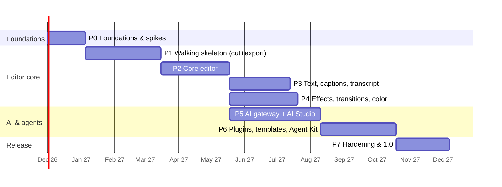

# Cutweave — Roadmap: Phases, Milestones & Exit Criteria

> Status: baseline 2026-11-22. Durations are **rough** and get re-estimated at the end of Phase 0. They assume 1–2 senior human maintainers acting as reviewers and integrators, plus AI coding agents doing most implementation (see [06-dev-process.md](06-dev-process.md)).
> Each phase is decomposed into work packages (WPs) in [05-work-breakdown.md](05-work-breakdown.md). The CapCut feature → phase mapping is in [03-feature-parity.md](03-feature-parity.md).

## At a glance



| Milestone | Ends | Audience | Headline |
|---|---|---|---|
| **M0 — Go/No-Go** | P0 | team | Spikes passed; stack ADRs accepted |
| **M1 — Skeleton** | P1 | team | Import → cut → export, from the UI *and* from an MCP agent |
| **M2 — Dogfood** | P2 | team + friends | Edit a real 10-min YouTube video and a 9:16 short |
| **M3 — Public Alpha** | P3 | early adopters | Captioned short from talking-head footage in < 5 min |
| **M4 — Creative parity** | P4 | alpha | CapCut-class effects, transitions, filters, color and masks |
| **M5 — AI Studio** | P5 | alpha | Leading models integrated; AI features end-to-end |
| **M6 — Beta** | P6 | public beta | Plugins, templates, Agent Kit, copilot, full MCP parity |
| **1.0** | P7 | everyone | Signed installers, auto-update, docs, performance budgets met |

Rough total: about **14 months to 1.0** (53 weeks of scheduled phases plus about 15% buffer) and **about 7.5 months to Public Alpha**. P3, P4 and P5 overlap; they are separate tracks with separate owners.

**Effort (from the WBS):** about **1,250 agent-days** across **482 work packages** (S = 1, M = 3 agent-days):

| Phase | P0 | P1 | P2 | P3 | P4 | P5 | P6 | P7 |
|---|---|---|---|---|---|---|---|---|
| Agent-days | 100 | 156 | 162 | 154 | 135 | 203 | 232 | 104 |

At about 6 parallel agents, that is roughly 40 weeks of pure execution. Serial dependencies, reviews and gates make up the rest of the calendar. **Human review capacity is the real bottleneck**, not agent throughput.

**Staffing reality:** P3, P4 and P5 run in parallel, and each needs one accountable human reviewer. With a single maintainer, run P5 after P3; this adds about 6 weeks.

---

## Phase 0 — Foundations & Spikes (≈5 weeks) → M0

**Day-0 prerequisites (human, before any WP starts):**
- Create the `cutweave/cutweave` repo in the existing org, plus the Git LFS quota, a `cutweave-testdata` repo and CI secrets.
- **Order the reference hardware.** It is long-lead and gates the spike measurements.
- Name the owner of the hardware and runners, and a legal reviewer for the license texts.

**Goal:** remove the existential risks before writing product code. Spike code is throwaway, in `spikes/`, and **is not merged into crates**.

| # | Spike | Pass criteria (all must hold on Windows 11, macOS arm64 and Ubuntu 24.04 X11 + Wayland) | On fail |
|---|---|---|---|
| S1 | **Shell & preview path.** Electron + Rust sidecar renders 1080p60 into an SHM ring, which the renderer shows on a WebGPU canvas with a DOM overlay (draggable transform box, scrub bar). Live resize. Canvas2D timeline stress test: 5k clips, 50k keyframes, 200 thumbnails | 60 fps sustained, < 2 dropped frames/min, scrub-to-pixel p95 < 80 ms, CPU overhead of the transport < 15%, timeline ≥ 55 fps, no overlay or z-order issues | Build the same demo in **GPUI**, compare, decide ADR-001 |
| S2 | **Audio clock & A/V sync.** cpal mixer: 8 tracks, rubato, signalsmith-stretch 0.5×–2×, ebur128; video follows the audio clock | Drift < 1 frame / 30 min; 0 underruns at a 256-sample buffer; A/V offset < 40 ms (flash/click test) | Larger buffers + latency compensation; evaluate Rubber Band |
| S3 | **Decode, seek & HW accel.** ffmpeg-next: H.264 4K30, HEVC 10-bit, ProRes, VFR phone clip; keyframe index; frame-exact seek; HW decode with CPU upload (a) and zero-copy (b) | 100% frame-exact on 500 random seeks; 4K long-GOP scrub p95 < 150 ms (proxy < 33 ms); (a) works everywhere | Ship (a) only; defer zero-copy |
| S4 | **Compositor, color, text.** Render graph: 3 layers, 2 blend modes, dissolve, LUT, linear Rgba16Float, PQ→SDR tone-map; animated caption (outline, shadow, per-word pop, karaoke) via MSDF and Vello; headless export | 1080p60 at < 8 ms GPU on an iGPU; PSNR > 45 dB vs reference; ΔE < 2; crisp 4K text; 1000 animated glyphs < 1 ms | skia-safe evaluation |
| S4b | **Compositions runtime.** oxc transpile of a TSX lower-third, run in rquickjs, scene graph rendered by the S4 compositor | Transpile < 50 ms; scene eval < 1 ms/frame for 200 nodes; deterministic across runs; sandbox (no I/O) enforced | Simplify to declarative JSON scenes + expressions |
| S5 | **Command bus → codegen → MCP.** `#[command]` macro, JSON Schema + specta TS output, rmcp server (stdio + HTTP) exposing 5 commands + `render_frame` image; an MCP client script drives a headless edit | Schemas generated and snapshot-tested; MCP Inspector passes; an agent (Claude Code) completes "import, cut, render frame" with no screenshots | Adjust the macro design; pin the rmcp version |

**Also in P0 (non-spike):**
- Repository scaffold (workspace layout per architecture §3), CI matrix, lint and format, `cargo-deny`, license headers, DCO bot.
- `LICENSE` (GPL-3.0) plus the plugin exception text, `CONTRIBUTING.md`, `CODE_OF_CONDUCT.md`, ADR template and ADRs 001–013.
- `CLAUDE.md` / `AGENTS.md` for coding agents.
- Test-media corpus manifest and fetch script.
- Reference machines and the benchmark harness skeleton.
- Decide minimum supported OS versions.
- **Design system foundations (epic 0K):** token pipeline with contrast check, bundled OFL fonts, icon set (Lucide + editor glyphs), `packages/ui` primitives, Storybook with both themes, visual regression and the no-literal-values lint. See [07-design-system.md](07-design-system.md).

**Exit (M0):** all spikes pass or have an accepted fallback; ADRs 001/003/007/009/012 are marked Accepted; durations are re-estimated.

---

## Phase 1 — Walking Skeleton (≈10 weeks) → M1

**Goal:** the thinnest end-to-end product through *every* architectural layer, with production-quality foundations.

- **Model & commands:** `cutweave-model` v1 (project, media, one sequence, video/audio tracks, clips), flicks time, IDs, schema v1, migrations framework. `cutweave-commands` with transactions, invertible patches, undo/redo, revisions, actors, and property tests.
- **Persistence:** project folder format, atomic save, autosave, journal, crash recovery, lock file.
- **Media:** probe, index, decode (CPU path + HW decode), thumbnails, waveforms, frame cache. Export: H.264/AAC MP4 (HW and software).
- **Render:** single-layer compositor (transform/opacity only), linear-light pipeline, preview quality ladder.
- **Audio:** playback of clip audio, master clock, volume.
- **Playback:** SHM preview ring, transport (play/pause/seek/scrub/JKL).
- **API:** WS JSON-RPC, media HTTP endpoints, token auth, run-file discovery.
- **MCP v0:** rmcp server (HTTP + stdio `attach`/`headless`), 15 core tools (the P1 subset of §14, including `render_frame` and `job_wait`) plus the 4 generic tools. P2 completes the ~30-tool core set.
- **CLI:** `cutweave engine | mcp | exec | query | render`.
- **UI** (built only from `packages/ui` and design tokens): Electron shell, engine supervision and restart, media bin (import/drag-drop, search and filters, hover-scrub), preview (with a Source view that plays a media asset before it is placed), a basic timeline (1 video + 1 audio track: select, move, trim, split, delete), minimal inspector, undo/redo, save/open, export dialog, and the Settings frame with its first pages (general, appearance, saving, export, shortcuts, agents and MCP, cache and hardware).
- **Codegen:** TS protocol package generated in CI with a snapshot diff gate.

**Exit (M1):**
1. Through the UI: import 3 clips, arrange, trim, split, export a 1080p MP4 that plays correctly.
2. Through MCP headless: a scripted client does the same.
   - The CLI, MCP and RPC paths produce **byte-identical** project documents (deterministic-ID mode).
   - The UI path is driven by numeric input and the command palette, and matches by normalized structure.
3. Kill the engine mid-edit: the UI recovers with no lost commands.
4. CI is green on 3 OSes; golden frames pass; the parity test (CLI = MCP = RPC) passes.

---

## Phase 2 — Core Editor (≈9 weeks) → M2

**Goal:** a genuinely usable everyday editor for both long-form and short-form.

- **Timeline:**
  - Unlimited video/audio/overlay tracks; magnetic main track; linked clips.
  - Ripple, roll, slip and slide; snapping (playhead, edges, markers, beats).
  - Markers, in/out, copy/paste/duplicate, multi-select, linked-group selection.
  - Track lock, mute, solo and hide; zoom/scroll performance.
  - Source marks and three-point editing (insert, overwrite, match frame) from the Source view.
  - **Replace clip** (keeps attributes and effects); **compound clips** (nested sequences, §4.3).
  - Auto-create tracks on overlap (§4.3).
- **Sequences:** multiple sequences per project; sequence settings with aspect presets (16:9, 9:16, 1:1, 4:5, 21:9); background fill (color, blur, image).
- **Clip properties:** transform, crop, opacity, flip, core blend modes (§8), layouts for several clips (side by side, top and bottom, picture in picture, grids), and **keyframes** for all animatable props with easing curves; keyframe lanes in the timeline plus a **bezier graph editor**. Keyframe math is shared with the UI via wasm (§16).
- **Speed:** constant speed with pitch preservation, reverse, freeze frame.
- **Audio:**
  - Fades, keyframed volume, pan, track buses, master limiter, loudness normalization presets.
  - **Auto-ducking** (sidechain from voice tracks).
  - **Basic voice effects** (offline DSP: pitch, robot, echo, telephone, chipmunk/deep).
  - Voiceover recording, extract audio.
- **Media:** proxies (auto policy + manual), relink, collect & archive, image and image-sequence support, still duration defaults, **media bin folders, tags and smart collections**, project settings, and the settings pages for editing, timeline, playback, audio and appearance ([settings catalog](reference/settings.md)).
- **Export:**
  - Presets: YouTube 1080p/4K, YouTube Shorts, Instagram Reels, Stories and feed, TikTok, X (with dated platform limits and safe areas), GIF, audio-only, ProRes. HEVC/AV1.
  - **Advanced controls:** bitrate mode (CBR/VBR/CRF), GOP, color tags, audio codec and bitrate.
  - Background export queue; export a range or a marker set.
- **Background render cache** for heavy segments (smart pre-render while idle).
- **UI:**
  - Dockable workspace with "Short-form" / "Long-form" layouts, with every panel built from design-system components (TimelineClip, TrackHeader, Playhead, AssetTile, InspectorSection, CommandPalette).
  - Schema-driven inspector, command palette and a shortcut editor (default NLE + CapCut presets).
  - Panels that close and reopen from View > Panels; a History panel listing every undo step and who made it.
  - Preview overlays (transform handles, safe areas, grid), timeline thumbnails and waveforms, i18n scaffold.
- **MCP:** core tool set complete for editing (~30 tools), `render_contact_sheet`, `media_filmstrip`, `audio_waveform`, checkpoints, `expected_rev`, tool profiles.
- **Performance:** benchmark suite in CI against architecture §19 budgets (timeline, scrub, playback, command RTT).

**Exit (M2):** two dogfood edits are completed by a non-developer: a 10-min multi-cam-free YouTube video with B-roll, and a 9:16 short with manual reframe, music and fades. Performance budgets for timeline, scrub and playback are met on reference machines. No data loss across 20 forced crashes.

---

## Phase 3 — Text, Captions & Transcript Editing (≈8 weeks) → M3 Public Alpha

> **Started early (2026-11-28, [R37](05-work-breakdown.md)):** the text chain (WP-3A.01 to 3A.05) and the plugins skeleton (WP-3B.01) run beside the end of Phase 2.

**Goal:** CapCut's moat: fast, beautiful captions and text-driven editing.

- **Text engine:**
  - Rich text with fonts (system plus bundled open fonts), fill, outline, shadow, glow, background box, gradient, letter/line spacing, alignment and auto-fit.
  - **Curved text / text on path.**
  - Text presets library.
  - Text animations (in/out/loop) built as compositions; per-glyph, word and line animators.
- **Plugin loader v0:** `cutweave-plugins` skeleton for *first-party* L0/L1/L1.5 packages, with manifest parsing and a registry. P4 effects build on it, and P6 generalizes it to third-party, WASM and permissions (extend, never replace).
- **Compositions runtime:** `@cutweave/compose` v1, QuickJS host, inspector from props schema. First-party compositions: lower thirds, titles, callouts, progress bars, subscribe buttons.
- **Transcripts:**
  - Stt capability with the **first providers: one cloud (e.g. ElevenLabs Scribe or Deepgram) plus local whisper.cpp** as a fallback plugin.
  - Word-level transcript model, speaker labels, transcript panel with search.
  - **Lyrics recognition** (music with vocals → timed lyric captions) and LRC import.
- **Captions:**
  - Auto captions to a caption track with chunking rules.
  - **Caption style gallery (≥ 25 styles)**: active-word highlight, karaoke, pop and bounce, emoji emphasis.
  - SRT/VTT/ASS import/export, burn-in or sidecar, bilingual layout.
- **Text-based editing:** delete or reorder transcript words to edit the timeline; **silence removal** and **filler-word removal** with a review UI.
- **Assets:**
  - Sticker/overlay packs (L0), including **animated stickers** (GIF/APNG/animated WebP/Lottie), and emoji.
  - A basic music and SFX library (CC0 sources) with **license metadata per asset**.
- **Agent Kit v0:** MCP tools for captions/transcripts; first skills `cutweave-basics`, `captions-and-styling`, `transcript-editing` (silence and filler cuts) and `reframe-and-aspect` (manual reframe), using the canonical names from architecture §14b, with their MCP prompts (`caption-pass`, `tighten`).

**Exit (M3, Public Alpha):** a new user turns a 3-min talking-head clip into a styled, captioned, silence-cut 9:16 short with music in **under 5 minutes**. An agent does the same via MCP from a one-line instruction. Installers exist for all 3 OSes (unsigned OK for alpha).

---

## Phase 4 — Effects, Transitions & Color (≈9 weeks, parallel with P3/P5) → M4

> **Started early (2026-11-28, [R37](05-work-breakdown.md)):** the effect framework and transitions engine (WP-4A.01 to 4A.04, 4A.06), then the dissolves and fades (4B.01) and blur and glow (4C.01) packs, run beside the end of Phase 2.

**Goal:** creative parity with CapCut's visual toolbox, built entirely on the L1 plugin interface.

- **WGSL effect framework:** `effect.toml` spec, param types, multi-pass, keyframeable params, validation, GPU budgets, hot-reload for authors.
- **Built-in packs** (first-party plugins):
  - **≥ 40 transitions** (dissolves, wipes, zooms, spins, glitch, light leaks, slide/push, blur).
  - **≥ 50 video effects** (blur, glow, VHS, RGB split, shake, zoom pulse, film grain, vignette, pixelate, mirror, kaleidoscope, lens distortion).
  - **≥ 40 filters/LUTs**.
  - Clip animations in/out/combo.
- **Color:**
  - Basic adjustments (exposure, contrast, highlights, shadows, whites, blacks, temperature, tint, saturation, vibrance), HSL per hue, curves (RGB + per channel), LUT import (.cube), color wheels (basic).
  - Scopes (waveform, vectorscope, histogram).
  - **Auto color correct** and **color match to a reference frame** (statistics-based; AI variants in P5).
- **Masks & keying:** shape masks (feather, invert, keyframeable), chroma key (spill suppression), luma key, adjustment layers.
- **Speed:** speed curves (presets: montage, hero, bullet, flash in/out), optical-flow frame blending (basic). AI interpolation comes in P5.
- **Motion:** stabilization (via FFmpeg vidstab analysis job), and **motion tracking** (point/planar-lite) driving keyframes.

**Exit (M4):** a "CapCut trend recreation" test suite (10 reference edits recreated using only built-ins) passes design review. All effects render identically in preview and export (golden frames). Each effect stays within its GPU budget on the iGPU reference machine.

---

## Phase 5 — AI Gateway & AI Studio (≈12 weeks, starts after M2) → M5

**Goal:** the Higgsfield-style "all leading models" layer, plus CapCut's AI features.

- **Gateway:**
  - Capability enum, normalized I/O types, provider interface.
  - Persistent job manager, polling/backoff, result download, input-hash cache.
  - Budgets and cost estimates, keychain storage, provenance sidecars, C2PA read/write.
- **Catalog:** manifest schema, CI-built **signed catalog**, live discovery from aggregators, user-added model slugs, deprecation handling.
- **Adapters (first wave):**
  - Aggregators: **fal, Replicate, OpenRouter, Higgsfield**.
  - Direct: **Anthropic, OpenAI-compatible, Google Gemini, ElevenLabs, Runway, Deepgram/AssemblyAI**.
  - Declarative HTTP manifest format (first-party adapters are compiled-in Rust). Third-party WASM adapters ship with the plugin platform in P6.
  - Test accounts and keys for recording contract-test fixtures (cassettes) are a maintainer task; live smoke tests use CI secrets and are opt-in.
- **AI Studio panel:**
  - Generate images, video (text and image to video, first/last frame, camera controls), music, SFX and voice.
  - Model picker with capability filters, presets/prompt packs, cost display, a results gallery and send-to-timeline.
  - "Extend clip" and "fill gap" generation in the timeline.
- **AI features (cloud-first, local fallbacks where cheap):**
  - Background removal / smart cutout (video matting to an alpha matte) and click-to-track object masks.
  - Auto reframe (subject tracking to a keyframed crop).
  - Voice enhance/denoise and stem split.
  - TTS voiceover, voice changer, caption translation, dubbing with optional lip-sync.
  - Upscale, frame interpolation (slow-mo), beat detection to markers, scene detection.
  - **Long video → shorts** (transcript plus video understanding: ranked highlight candidates become new sequences).
- **Local AI plugin:** whisper.cpp, ONNX Runtime models (matting, denoise, scene/beat detection, **Kokoro TTS fallback**) with an on-demand model manager and license display.
- **Stock media:** a `StockSearch` capability with adapters for free stock APIs (Pexels/Pixabay-class), browsable in the asset panel. Licenses are recorded in provenance.
- **Agent Kit additions:** skills `generate-shots`, `b-roll-insertion`, `dubbing-and-translation` (includes TTS voiceover) and `shorts-from-longform` (§14b names), plus prompt/preset packs per model family.

**Dependencies:** matting and object masks build on P4 masks (E4G), interpolation on frame blending (E4H), and reframe on tracking (E4I). Those WPs wait for their P4 epic. Everything else starts at M2.

**Exit (M5):**
- Each first-wave adapter passes a contract-test suite (recorded fixtures plus an opt-in live smoke test).
- **Every AI feature listed above runs end-to-end**: background removal, object masks, auto reframe, voice enhance, stem split, TTS, voice changer, caption translation, dubbing (+lip-sync), upscale, interpolation, beat/scene detection and stock search. Each shows its cost up front, records provenance and is undoable.
- The three-tier spending authority (§13) passes its security tests. Long → shorts produces ≥ 3 usable shorts from a 20-min podcast in a blind review.

---

## Phase 6 — Plugins, Templates, Agent Kit & Copilot (≈10 weeks) → M6 Beta

> Sized at ~86 WPs and ~230 agent-days, the largest phase. If review capacity is short, these are **Should** items that can slip into P7 or 1.1: the TikTok publisher, FCPXML export and the last template batch.

- **Plugin platform:**
  - Manifest v1, permissions UI, wasmtime host for providers/importers/exporters/publishers/command handlers.
  - L3 UI panels (iframe SDK), git-based plugin index with signing, in-app browse/install/update.
  - `cutweave plugin` CLI with scaffolds for every layer, and docs plus example plugins.
- **Templates:**
  - Template format (project fragment + replaceable slots + compositions), "save as template", template browser.
  - **≥ 30 first-party templates** (intros, vlog, podcast clip, product promo, listicle, meme formats).
  - Smart templates: auto-fill slots from the media bin.
  - **Brand kit** (fonts, colors, logo, caption style, intro/outro, tone of voice) with its own UI. Templates, the copilot and the Agent Kit consume it.
- **Interchange:** OTIO import/export, FCPXML/EDL export, CapCut draft import investigation (go/no-go).
- **Publishing:** YouTube and TikTok upload publishers (OAuth in the engine), with metadata from a transcript-based LLM summary.
- **Agent Kit v1** (full; see [research/08-agent-harness.md](research/08-agent-harness.md)):
  - A skills pack of ~12–15 skills (`SKILL.md`), an MCP prompts catalog and the prompt/preset packs format.
  - `AGENTS.md` for projects.
  - An **eval harness** (task suite with state assertions plus a vision rubric judge) run nightly.
  - Published install guides for Claude Code/Desktop, Codex, Gemini CLI, Cursor and VS Code.
- **Copilot:**
  - An in-app chat panel with a provider-agnostic agent loop over the same tool catalog, loading skills on demand.
  - Brand kit and user preferences memory.
  - Plan → preview → apply flow with per-actor undo, cost and destructive-action gates.
- **MCP completeness:** CI parity test asserts 100% of commands are reachable; tool-list size budget; conformance on old and new spec clients.

**Exit (M6, Beta):**
- A third-party developer builds and publishes an effect, a provider adapter and a panel using only the docs.
- The eval suite reaches ≥ 80% task success with at least two different agent clients.
- The copilot completes the 10 most common CapCut workflows from natural language.

---

## Phase 7 — Hardening & 1.0 (≈7 weeks)

- **Packaging:** signed and notarized installers for all formats, Flatpak on Flathub, staged auto-update channels (stable/beta/nightly).
- **Design:** high-contrast theme (7:1) added to `design/tokens.json`; logo and wordmark refined by a designer; design-system artifact re-synced from code.
- **Quality:** crash-free session rate ≥ 99.5% **measured only among opted-in beta users** (self-hosted, privacy-preserving crash reporting, n ≥ 2,000 sessions; no counting for users who did not opt in), a fuzzing campaign, a soak-test matrix, accessibility audit (WCAG 2.2 AA for UI chrome), i18n (en plus ≥ 6 languages, RTL check).
- **Performance:** every architecture §19 budget is green in CI; memory profiling on long projects.
- **Docs:**
  - User guide and "coming from CapCut" guide.
  - Plugin SDK reference, MCP/agent guide and auto-generated command reference.
  - Contributor docs and a governance doc (maintainers, RFC process).
- **Legal/compliance:** third-party notices, FFmpeg source offer, codec patent posture review, model-license display, security review of the local API and plugin sandbox.
- **Launch:** website, sample projects, template gallery, community channels.

**Exit (1.0) gates:**
1. Signed and notarized installers for every target, verified on clean VMs. Auto-update tested across two releases.
2. Every §19 performance budget green for 7 consecutive nightly runs on the reference machines.
3. Crash-free ≥ 99.5% (opted-in beta, n ≥ 2,000) over the final 14 days. No open P0/P1 bugs.
   - Fallback if n < 2,000: ≥ 99.5% over ≥ 500 sessions, plus a 72-hour zero-crash soak matrix and zero data-loss bugs.
4. WCAG 2.2 AA audit for the UI chrome passed. At least 6 languages complete.
5. Docs complete: user guide, coming-from-CapCut, SDK, MCP/agents, command reference.
6. Legal and security checklist complete: notices, FFmpeg source offer, codec posture, plugin exception, local-API and sandbox review.
7. Agent Kit evals ≥ 80% on two clients. MCP conformance green.
8. Product-owner go/no-go.

## Long-lead items (start early; owner: product owner and maintainers)

| Item | Start by | Why early |
|---|---|---|
| Apple Developer account + notarization; Windows code signing (Azure Trusted Signing or EV cert) | P1 | Identity verification takes weeks; needed for alpha installers in P3 |
| Domain(s), trademark search for "Cutweave", social handles | P0 | Brand protection before public alpha |
| YouTube Data API and TikTok Content Posting API app review/audit | P4 | Audits can take weeks to months; needed for P6 publishers |
| Flathub submission and review | P5 | External review queue |
| Provider test accounts and CI secrets (fixture recording) | P3 | Needed by 3D and P5 contract tests |
| Codec patent posture and legal review (H.264/HEVC/AAC) | P3 | Must be settled before public binaries at scale |
| Plugin-exception license text (legal review) | P0 | Before the first external contribution |

---

## After 1.0 (candidate themes, in rough order)

1. Browser "lite" editor (wasm engine + WebCodecs + mediabunny).
2. Real-time collaboration (Loro CRDT) and optional self-hostable project sync.
3. CLAP then VST3 audio plugin hosting.
4. HDR output.
5. Multicam editing (a "lite" version first: audio-sync plus angle switching).
6. Face and body effects, beauty retouch and eye contact (face-landmark capability).
7. Screen and webcam recording; phone-to-desktop QR import.
8. Region-prompt generative edits (inpaint in video).
9. Node-based compositing view.
10. Distributed/cloud rendering.
11. Mobile companion app.
12. OFX bridge.

## Work package template (used in 05-work-breakdown.md)

```markdown
### WP-<phase>.<nn> — <title>
- **Area:** crates/… | packages/… | apps/… | docs/…
- **Depends on:** WP-…, WP-…
- **Size:** S (≤ 1 agent-day) | M (2–4) | L (5–10) — L must be split before start
- **Executor:** sonnet | opus | human (design/review-critical) — default sonnet
- **Scope:** what to build (bullets)
- **Interfaces:** public types/commands/APIs touched or created
- **Acceptance criteria:** objectively checkable bullets
- **Tests:** unit / property / golden / e2e / bench additions
- **Out of scope:** explicit exclusions
```
