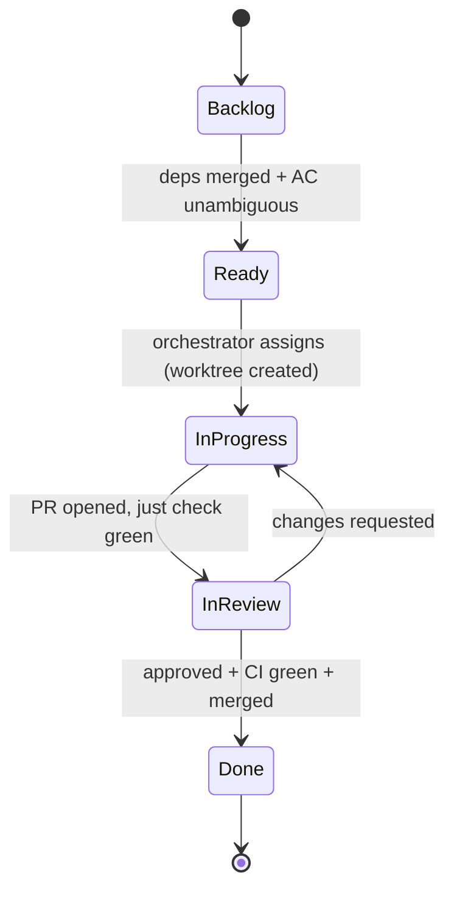

# Cutweave — Development Process (building it locally with AI agents)

> How a small human team plus AI coding agents turns [05-work-breakdown.md](05-work-breakdown.md) into shipped software without losing architectural integrity.

## 1. Roles

| Role | Who | Responsibilities |
|---|---|---|
| **Product owner** | Human (project founder) | Priorities, scope trade-offs, milestone sign-off, naming/brand, legal decisions |
| **Tech lead / maintainer(s)** | 1–2 humans | Approve ADRs, review `exec:opus`/`exec:human` WPs, merge rights, release signing |
| **Orchestrator** | Opus agent (PM / integrator) | Picks ready WPs, writes briefs, dispatches workers, reviews against contracts, keeps docs consistent, resolves integrator notes |
| **Workers** | Sonnet agents (default), Opus for `exec:opus` WPs | Implement one WP each in an isolated git worktree; tests first; open a PR |
| **Reviewer** | Opus agent or a fresh Sonnet agent given *only the diff and the contracts* (not the worker's reasoning) | An independent review not anchored on the implementer's view |
| **CI** | GitHub Actions | The final arbiter: nothing merges red |

## 2. Local environment

**Prerequisites (all OSes):** Rust stable via `rustup` (the toolchain is pinned in `rust-toolchain.toml`), Node LTS with `corepack enable` (pnpm), `just` (task runner), LLVM/clang (bindgen), Git LFS (golden frames), and current GPU drivers.

| OS | FFmpeg dev libraries | Notes |
|---|---|---|
| Windows 11 | `just ffmpeg-fetch` downloads the pinned CI-built shared bundle and sets `FFMPEG_DIR` | MSVC build tools; WARP is used for headless GPU tests |
| macOS (arm64) | `just ffmpeg-fetch` (pinned bundle); `brew install ffmpeg` works for quick hacking | Xcode CLT; codesign identity only needed for release |
| Linux (Ubuntu 24.04) | `just ffmpeg-fetch` (pinned) or distro `libav*-dev` for quick hacking | Mesa/lavapipe for headless tests; test both X11 and Wayland sessions |

**Core recipes (`justfile`):**

| Recipe | What it does |
|---|---|
| `just setup` | Toolchains, pnpm install, FFmpeg bundle, git hooks, test-corpus manifest |
| `just dev` | Engine (cargo watch) + Electron with Vite HMR, wired to a dev project |
| `just check` | fmt, clippy `-D warnings`, Biome, `cargo nextest`, vitest, wasm32 check of wasm-safe crates, cargo-deny, schema/codegen snapshot diff. **Must pass before any PR** |
| `just golden [--update]` | Render golden-frame projects headless and compare (update requires a human-approved PR label) |
| `just bench [--compare main]` | Criterion + engine benchmarks against the §19 budgets |
| `just e2e` | Playwright + Electron flows |
| `just mcp-inspect` | Start the headless engine and run the MCP conformance/inspector suite |
| `just corpus` | Fetch the test-media corpus (not committed; checksummed) |
| `just evals [--client claude\|codex\|…]` | Run Agent Kit eval tasks (Phase 6+) |

## 3. Repository conventions

- **Trunk-based development.** Short-lived branches `wp/<WP-id>-<slug>` (e.g. `wp/1B.04-undo-property-tests`). Squash-merge into `main`.
- **Conventional commits** (`feat(engine):`, `fix(timeline):`, …) with **DCO sign-off** (`git commit -s`). AI-authored commits carry a `Co-Authored-By` trailer for the model.
- **PR template:** WP id and link, acceptance-criteria checklist with evidence (test names, benchmark numbers, screenshots or golden diffs), affected contracts (architecture § numbers), and a "Notes for integrator" section.
- **CODEOWNERS:** `crates/*-model`, `*-commands`, `*-render`, `*-api`, `wit/`, and `docs/01-architecture.md` require tech-lead review.
- **Contracts change only via ADR.** A PR that changes a public command schema, a WIT interface, the project file format or the plugin manifest needs a linked ADR or RFC.

## 4. Work-package lifecycle

- **Issues are generated from the WBS.** `scripts/wbs-to-issues` parses `docs/wbs/*.md` and creates or updates GitHub issues. The project board carries the fields Phase, Epic, Size, Executor and Status. The WBS markdown stays the source of truth.
- **Ready means:** every dependency is merged, the acceptance criteria are testable, and the touched files don't overlap another in-progress WP.
- **Split rule:** if a worker estimates more than 4 agent-days or finds hidden scope, it stops, writes a split proposal and returns.

## 5. The orchestration loop (how agents build Cutweave)

1. **Select.** The orchestrator lists Ready WPs and picks up to *N* in parallel (start with 4–6, bounded by review capacity). It never runs two writers in the same crate or package area at once.
2. **Brief.** Each worker gets:
   - the WP text verbatim;
   - links to the architecture sections it touches;
   - the relevant existing code paths;
   - "do-not" constraints: no contract changes, no new dependencies without justification, no TODOs without issues;
   - the Definition of Done.
3. **Implement (worker, in its own worktree).**
   - Read the code, then write failing tests from the acceptance criteria, then implement.
   - Run `just check` plus any WP-specific gates (golden, bench, e2e).
   - Open the PR with evidence, and report blockers immediately rather than guessing.
4. **Review.**
   - An independent reviewer gets the diff, the WP and the contracts, and checks with the review checklist (§7).
   - `exec:opus` and `exec:human` WPs also need a human approval.
5. **Merge & integrate.**
   - Merge after CI is green.
   - The orchestrator updates WP status, folds "Notes for integrator" into the docs or new WPs, and re-plans the next batch.
6. **Phase gate.** When the traceability table shows every exit criterion met, run the milestone review: human sign-off, a demo recording and a re-estimate of the next phase.

**Cost control:**
- Sonnet is the default executor. Opus is for design-heavy, concurrency or GPU work and for reviews.
- Cap parallel workers; give each WP a token budget scaled to its size.
- Kill-and-split runaway sessions instead of letting them loop.
- Track agent-days per epic against the WBS estimate and re-plan when drift exceeds 30%.

## 6. Definition of Done (every WP)

- [ ] All acceptance criteria are met, with evidence linked in the PR.
- [ ] Tests are added at the level the WP specifies (unit, property, golden, e2e, bench). New commands get the undo/redo property test automatically through the registry harness.
- [ ] `just check` is green; WP-specific gates are green; no benchmark regression above 5% without approval.
- [ ] Every new mutation is a **registered command**, shows up in the generated schema, TS client and MCP catalog, and passes the parity test.
- [ ] No secrets or paths leaked into logs. Filesystem access goes through allowlists; network goes through the gateway only.
- [ ] Docs are updated: the command reference (auto-generated), plus user or dev docs if behaviour changed, plus an ADR if a decision was made.
- [ ] License headers are present, and no new dependency fails `cargo-deny` or the JS license check.

## 7. Review checklist

1. **Contracts:** matches architecture § numbers; no hidden schema or format change; IDs not indices; flicks for time.
2. **Command bus:** mutations go only through `Tx`; inverse ops are correct; errors are typed; it is validated before apply; MCP annotations are right (read-only, destructive, paid).
3. **Concurrency & real-time:** nothing blocks the audio or render threads; no locks on the hot path; cancellation is respected.
4. **GPU & media:** color tags honored; linear-light compositing; device-lost handled; no per-frame allocations in hot loops.
5. **Security:** keys never leave the engine; plugin permissions checked; untrusted text is labelled in MCP results.
6. **Tests:** they assert behaviour (not implementation) and are deterministic; golden updates are justified.
7. **UX (UI WPs):** keyboard-accessible, i18n strings, consistent with the design system, no layout jank at 60 fps.

## 8. CI quality gates

| When | Gates |
|---|---|
| Every PR | `just check` on Windows, macOS and Linux · golden frames (software GPU) · CLI = MCP = RPC parity · schema/codegen snapshot · MCP tools-list size budget · license and advisory scan |
| Nightly | Full media corpus · benchmarks against budgets on reference machines (self-hosted runners) · 30-min A/V soak · fuzzing (time-boxed) · Agent Kit evals (Phase 6+) · e2e on all OSes |
| Release | Signed builds · SBOM · notices · FFmpeg source bundle · update-channel promotion · smoke test of installers on clean VMs |

## 9. Decisions: ADRs & RFCs

- **ADR** (`docs/adr/NNNN-title.md`, MADR format; template `docs/adr/0000-template.md`) records an architectural decision: context, options, decision, consequences. Status: Proposed → Accepted / Superseded.
- **RFC** (`docs/rfc/`) covers larger user-visible or ecosystem changes: plugin API, project format, MCP surface. It has a two-week comment window once external contributors exist.
- The orchestrator may *draft* ADRs and RFCs; only maintainers accept them.

## 10. Spike protocol (Phase 0)

- Spike code lives in `spikes/<id>-<name>/`. It is time-boxed, and production code never depends on it.
- Each spike ends with `REPORT.md`: setup, measurements against the pass criteria (table), screenshots or recordings, decision, and an ADR link.
- Failing a spike is a *result*, not a failure. Trigger the documented fallback and re-plan.

## 11. Releases & versioning

- **App:** SemVer, with channels nightly → beta → stable and staged rollouts.
- **Host APIs** (WIT packages, `@cutweave/sdk`, `@cutweave/compose`, the command schema) are versioned **independently** with compatibility ranges. Breaking changes require a deprecation cycle of at least one minor release.
- **Project file:** `schema_version` with forward migrations; older apps open newer files read-only.
- Changelogs are generated from conventional commits and curated for user-facing notes.

## 12. Agent instructions in the repo

`AGENTS.md` (read by Codex, Gemini CLI, Cursor and others) is canonical; `CLAUDE.md` imports it. It holds the condensed rules every coding agent must follow: crate boundaries, the command-bus rule, testing expectations, how to run things, and the do-not list. Keep it under ~150 lines and link to the docs for depth.
