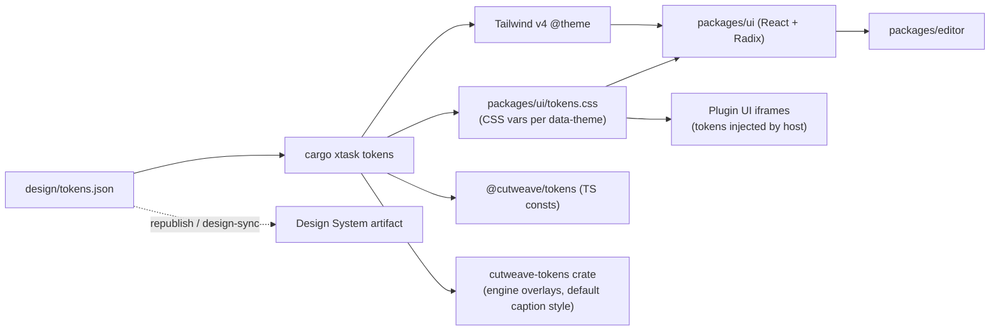

# Cutweave — Design System

> One look across the product: the desktop app, plugin panels, the website, docs and anything the Agent Kit renders.
> **Browsable reference (tokens, type, live component previews, guidelines):** [Cutweave Design System artifact](https://claude.ai/artifact/573tiShNRj7J6eiGyApFiH). **Canonical source in the repo:** [`design/`](../design/).

## What it is

| Part | Where | Notes |
|---|---|---|
| Brand book (principles, voice, color, type, space, motion, icons, logo) | [`design/README.md`](../design/README.md) | Usage rules that name tokens. Read this before building any UI |
| Tokens (both themes) | [`design/tokens.json`](../design/tokens.json) | **The single source of truth.** Colors, type styles, spacing, radius, shadow, size, z-index, duration, easing |
| Generated CSS (preview) | [`design/tokens.css`](../design/tokens.css) | Made by `design/scripts/tokens_to_css.py`. WP-0K.01 replaces it with the full pipeline |
| Logo | [`design/assets/logos/`](../design/assets/logos/) | Mark in marigold and ink. v0, to be refined by a designer before 1.0 |
| Component specs (30) | [`design/components/`](../design/components/) (mirrored in the artifact): live previews, `bundle.css` reference styles, per-component guidelines | The React implementations live in `packages/ui` (WP-0K.03/0K.04 and owning epics) |

## Design decisions (summary)

- **Dark-first, true-neutral chrome.** Surfaces are achromatic so footage color is judged correctly. The preview surround (`surface-preview`) is never tinted. Light theme is fully supported; a high-contrast theme (7:1) ships in P7.
- **One brand thread: marigold** (`#f2b33d`). Playhead, selection, active tool and primary action. Never decorative.
- **Agent blue** (`agent`) marks AI-generated media, agent proposals (dashed + hatched until accepted) and the copilot. It is never used for ordinary actions.
- **Clip families:** media, audio, graphics, captions and effects. Each has a strong and a body color, and every clip also carries a type icon.
- **Type:**
  - **Instrument Sans** for the UI, with a 13px base.
  - **Bricolage Grotesque** for brand moments only.
  - **JetBrains Mono** for timecode and numbers, with tabular figures.
  - All three are SIL OFL and bundled for offline use.
- **4px grid**, small radii (4/6/10), borders before shadows. Compact control heights (24/28/32) and minimum hit target of 24px (WCAG 2.2).
- **Motion is quiet.** 90/160/240 ms. Nothing animates during playback, and `prefers-reduced-motion` makes transitions instant.
- **Contrast is verified:** every text/background pair named in a token's usage note meets WCAG AA (4.5:1 text, 3:1 marks/borders/focus) in both themes, and CI enforces it (WP-0K.01).

## How code consumes it

- **Rules for every UI change** (also in [AGENTS.md](../AGENTS.md)):
  - Use `packages/ui` components and `var(--token)` values only. **No literal colors, sizes or font stacks** outside `design/` and generated files; a lint rule enforces this.
  - Missing a value? Add a token to `design/tokens.json` with a usage note in the same PR, regenerate, and pass the contrast check.
  - Editor-specific components (TimelineClip, TrackHeader, Playhead, Timecode, AssetTile, InspectorSection, ModelCard, CostChip, ProposalBar, ActorBadge, JobProgress, CommandPalette) are built in their owning epics from the artifact's specs.
  - Every story renders in both themes. Visual-regression screenshots and axe checks run in CI.
- **Plugins** (P6, epic 6B): the host injects the same CSS variables into sandboxed plugin iframes, and `@cutweave/sdk` re-exports `@cutweave/ui`. Third-party panels look native without copying values.
- **Not the same as user content.** Caption styles, text presets, templates and a user's **brand kit** are *content* rendered into the video. They may start from this palette, but they are owned by the user and never constrained by it.

## Governance

- **Owner:** a maintainer with design responsibility (until one exists, the tech lead). Token changes require their review (CODEOWNERS on `design/`).
- **Versioning:**
  - `tokens.json` has a `version`.
  - A renamed or removed token is a breaking change for plugins: deprecate it for one minor release first, with an alias token pointing to the new name.
- **Sync:**
  - The repo is canonical. After a token or brand-book change merges, the artifact is updated: republished from `design/` until `packages/ui` exists, then via `/design-sync` from code (WP-0K.06).
  - Edits made in the artifact page are copied back to the repo by PR, never left only there.
- **Before 1.0:**
  - A designer refines the logo and wordmark.
  - Trademark search for "Cutweave" (see the long-lead table in [04-roadmap.md](04-roadmap.md)).
  - A high-contrast theme and a WCAG 2.2 AA audit (P7, epic 7C).
