# @cutweave/timeline

The editor's timeline: a virtualized Canvas2D renderer (`TimelineView`, WP-2A.09), shared snapping through the engine's math module (`snap/`, WP-2A.07), and the interaction state machine that turns pointer and keyboard input into edits (`interaction/`, WP-2A.08). Nothing here talks to the engine; the editor wires it (WP-2A.10).

## Keyframe lanes (WP-2C.05)

`TimelineView.setKeyframeLanes(lanes)` (the `keyframeLanes` prop of `TimelineCanvas`) opens rows under a clip, one per animated property (`keyframes/`). The host projects them from the document: per lane the key times in sequence flicks, a glyph per key for its interpolation (diamond linear, square hold, circle bezier, triangle spring) and the selected keys. The clip's track grows by one `control-sm` row per lane; only the track geometry is rebuilt, the item index is the model's. Drawing is virtualized like the clips (only keys in the repainted range are walked), keys closer than 3 px collapse into one bar, and the marks of a track are batched into at most ten fills. Hit-testing answers zone `keyframe` with `prop` and `keyframeTime` for a mark (also inside a collapsed run: the nearest key), `keyframe-lane` for the empty part of a lane. Which lanes are open and which keys are selected is the host's view state, never the model's.

## Interaction state machine (WP-2A.08)

A framework-free, explicit finite state machine ([architecture §16](../../docs/01-architecture.md#16-ui-architecture-packageseditor-packagestimeline-appsdesktop), [timeline spec §5–§7](../../docs/spec/timeline-edit-semantics.md#5-gestures-and-soft-locks)). Events go in, intents come out:

```ts
import { createSnapPort, createTimelineMachine } from "@cutweave/timeline";

const machine = createTimelineMachine(
  {
    hitTest: (x, y) => view.hitTest(x, y),
    itemsInRect: (rect) => view.itemsInRect(rect),
    lanes: () => ({ left: headerWidth, right: width, top: rulerHeight, bottom: height }),
    snap: createSnapPort(), // the wasm index; initMath() must have resolved
    frames, // the canvas window's requestAnimationFrame
  },
  { model, sequence, tool: "select", pxPerSec, playhead, selection },
);
machine.subscribe((intents) => intents.forEach(carryOut));
machine.send({ type: "pointer.down", x, y, button: 0, shift, alt, ctrl, meta });
```

`transition(state, event, deps)` is the pure transition function underneath (it only queries `deps`); `createTimelineMachine` adds the state, listeners and animation frames.

### State chart

Every edge below is taken by at least one transcript test, and the machine takes no other: `interaction/coverage.test.ts` reads this diagram and fails otherwise (`pnpm --filter @cutweave/timeline check:machine` prints the coverage).

```mermaid
stateDiagram-v2
    [*] --> idle
    idle --> hover : pointer.over
    hover --> idle : pointer.leave
    hover --> idle : cancel
    hover --> pressed : pointer.down [clip]
    hover --> selecting : pointer.down [lane]
    hover --> scrubbing : pointer.down [ruler]
    hover --> panning : pointer.down [hand]
    hover --> zooming : pointer.down [zoom]
    hover --> razor : pointer.down [razor]
    pressed --> moving : threshold [move]
    pressed --> trimming : threshold [trim]
    pressed --> ripple_trimming : threshold [ripple]
    pressed --> rolling : threshold [roll]
    pressed --> slipping : threshold [slip]
    pressed --> sliding : threshold [slide]
    pressed --> keyframe_dragging : threshold [keyframe]
    pressed --> hover : pointer.up
    pressed --> idle : cancel
    pressed --> idle : aborted
    moving --> hover : pointer.up
    moving --> idle : cancel
    moving --> idle : aborted
    trimming --> hover : pointer.up
    trimming --> idle : cancel
    trimming --> idle : aborted
    ripple_trimming --> hover : pointer.up
    ripple_trimming --> idle : cancel
    ripple_trimming --> idle : aborted
    rolling --> hover : pointer.up
    rolling --> idle : cancel
    rolling --> idle : aborted
    slipping --> hover : pointer.up
    slipping --> idle : cancel
    slipping --> idle : aborted
    sliding --> hover : pointer.up
    sliding --> idle : cancel
    sliding --> idle : aborted
    keyframe_dragging --> hover : pointer.up
    keyframe_dragging --> idle : cancel
    keyframe_dragging --> idle : aborted
    selecting --> hover : pointer.up
    selecting --> idle : cancel
    scrubbing --> hover : pointer.up
    scrubbing --> idle : cancel
    panning --> hover : pointer.up
    panning --> idle : cancel
    zooming --> hover : pointer.up
    zooming --> idle : cancel
    razor --> hover : pointer.up
    razor --> idle : cancel
    idle --> dropping : media.over
    hover --> dropping : media.over
    dropping --> idle : media.drop
    dropping --> idle : media.leave
    dropping --> idle : cancel
    dropping --> idle : aborted
```



Edge labels: `pointer.over` is any pointer event over the canvas from `idle`; `threshold` is the pointer travelling 3 px from a press; `cancel` is Esc, `pointer.cancel` (lost capture) or `blur` (lost window); `aborted` is the engine closing the gesture (`gesture.cancelled` after 30 s idle, a refusal no later position can fix) or the dragged clip disappearing (another actor deleted it). States beyond the WBS list: `pressed` (a press that is still a click) and `dropping` (a bin card over the lanes).

### Gestures

Each gesture is one `gesture` transaction and one undo step ([spec §3.9](../../docs/spec/timeline-edit-semantics.md#39-one-undo-step-per-user-action)). Its updates carry the command for where the pointer is now; the engine applies each with `_meta.replace: true`, so the gesture commits the effect of its last update (INV-301). Gestures pass `clamp: true`.

| Tool                                       | Press on          | State               | Update                                                                      |
| ------------------------------------------ | ----------------- | ------------------- | --------------------------------------------------------------------------- |
| select                                     | clip body         | `moving`            | `item.move{items, start, to_track?, mode, unlink?}`                         |
| select, Alt held when the drag starts      | clip body         | `moving`            | `item.duplicate{items, offset, mode:"new_track"}` (main track: no offset)   |
| select                                     | clip edge         | `trimming`          | `clip.trim{item, edge, to, unlink?}` (the engine ripples on the main track) |
| select (with a keyframe handler, WP-2C.05) | keyframe          | `keyframe_dragging` | the handler's command (`keyframe.move`); it gets the lane's `prop`          |
| ripple                                     | clip edge         | `ripple_trimming`   | `clip.ripple_trim{item, edge, to, unlink?}`                                 |
| roll                                       | the edge at a cut | `rolling`           | `clip.roll{left, right, to}`; an edge with a gap beside it trims            |
| slip                                       | clip              | `slipping`          | `clip.slip{item, delta}` (drag right: earlier media); stills cannot slip    |
| slide                                      | clip              | `sliding`           | `clip.slide{item, delta}`                                                   |
| razor                                      | clip              | `razor`             | on release `clip.split{items, at}` (Shift: every clip at that time)         |
| hand, or the middle button                 | lanes             | `panning`           | `scroll_to`                                                                 |
| zoom                                       | lanes             | `zooming`           | click `zoom_by` 2 (Alt: ½), drag `zoom_to_range`                            |
| any                                        | ruler, playhead   | `scrubbing`         | `seek`                                                                      |
| (bin card)                                 | lanes             | `dropping`          | `timeline.insert{sequence, track, media, at, mode?}`                        |

Placement ([spec §3.6, INV-40, D8](../../docs/spec/timeline-edit-semantics.md#36-placement)): on the main track a clip or card goes in at the nearest cut of the layout without the movers (`mode: "insert"`); on a free track a dragged clip asks for `new_track` (a track above when it overlaps), and a card dropped onto a clip uses the Editing preference `dropOnClip` (`overwrite` by default, or `insert`), onto free space too short for it `new_track`. Tracks of another kind, and locked tracks, are never targets.

Modifiers: Shift+click adds or removes a clip's linked group, a Shift marquee adds; Shift during a drag constrains it to its main axis (time only, or track only). Alt+click selects one member of a linked group, an Alt marquee only the touched clips, Alt on an edge trims one member (`unlink: true`), Alt when a drag starts duplicates. Ctrl or Cmd held suspends snapping (the frame grid stays). A selection holding only part of a linked group edits with `unlink: true`, or, for commands without it (delete, ripple delete, split, slip, slide, roll), is refused with a `partial_group` notice (INV-342).

A key in a keyframe lane pressed with Shift, Ctrl or Cmd changes nothing in the machine (the host adds it to its key selection), and a press on the empty part of a lane is the host's too (a double-click adds a key). A key drag is not held back by a partly selected linked group: a key belongs to its clip alone.

Snapping ([spec §6](../../docs/spec/timeline-edit-semantics.md#6-snapping)) runs the engine's own code through `createSnapPort()`: candidates come from the document as it was when the drag started, without the movers and their linked partners, so the edge kind is rebuilt once per drag.

Keys (when the host's keymap gives no `action`): Esc cancels; S splits at the playhead; Delete/Backspace delete, with Shift ripple-delete; `,` and `.` nudge one frame (Shift: ten); N toggles snapping; V, B, R, Y, U, C, H, Z pick the select, ripple, roll, slip, slide, razor, hand and zoom tools. One-shot keys wait while a gesture runs.

### Engine traffic and feedback

- **Coalescing.** Pointer events only recompute the pending update. The machine asks for an animation frame while one is waiting; the `frame` event sends it. A drag therefore sends at most one `update_tx` per frame, whatever the pointer rate; the release sends the last position (if it is newer) right before `commit_tx`. Scrub seeks coalesce the same way. Auto-scroll steps once per frame near a lane edge, and the dragged clip follows.
- **Pairing.** Every `begin_tx` is closed by exactly one `commit_tx` or `cancel_tx`, and a release, Esc, a lost pointer or a lost window never leaves one open. A drag released before any update went out is cancelled (`reason: "unchanged"`). A `cancel_tx` with `reason: "engine"` closes the pairing only: the engine already rolled the transaction back.
- **Refusals.** Send the engine's answer to each update as `engine.result`. `invalid`, `locked` and `conflict{item_in_gesture}` keep the gesture open (the engine kept the previous update, INV-302): the cursor shows `not-allowed` or `locked` and the machine goes on; it never sends the same update again on its own. Any other refusal ends the gesture. `clamped: true` drops the snap guide.
- **Other actors.** `gesture.cancelled` for the person's gesture arrives as `engine.cancelled`: back to `idle`. Agents' edits arrive as `env.model`; a drag reads the document as it started, and ends (`target_gone`) only if a clip it edits disappears. Clips another actor holds (`env.heldBy`, from `edit.locks`) show the `locked` cursor.

### Wiring it into the editor (WP-2A.10)

- Feed `TimelineView.onPointer` events as `pointer.*` (canvas-relative x, y, the button and modifiers), `keydown`/`keyup` in the timeline panel as `key.*` with the keymap's `action`, window `blur` as `blur`, bin card drags as `media.*`, and toolbar buttons as `action`.
- Keep `env` current: `model` and `sequence` from `docStore`, zoom, scroll and playhead from `viewStore`/`playbackStore`, `selection` (item ids), `tool`, `snapping`, `linkedSelection`, the Editing and Timeline preferences (`dropOnClip`, `snapThresholdPx`, `snapKinds`), `inOut`, and `heldBy` from `locksStore.byItem`.
- Carry out the intents: `begin_tx` opens `edit.begin_tx{kind:"gesture"}` with the label of its `edit`; `update_tx` calls its command with `_meta: {tx, replace: true}` and answers with `engine.result`; `commit_tx`/`cancel_tx` close it; `command` runs one command (its refusal is a toast); `set_selection`, `set_tool`, `set_snapping`, `seek`, `scroll_*`, `zoom_*`, `snap_guides` (`viewState.snapGuides`), `marquee`, `preview` (the drop ghost) and `set_cursor` (overrides `TimelineView`'s own cursor, except `auto`) go to the view. After an insert, paste or duplicate commits, select what it created from the command's output (INV-343).
- Clicks on track headers, double-clicks, context menus and marker drags stay with the host: the machine ignores header presses and the secondary button.
